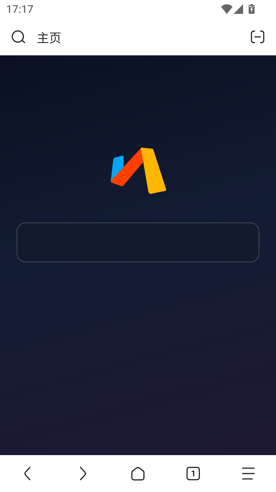
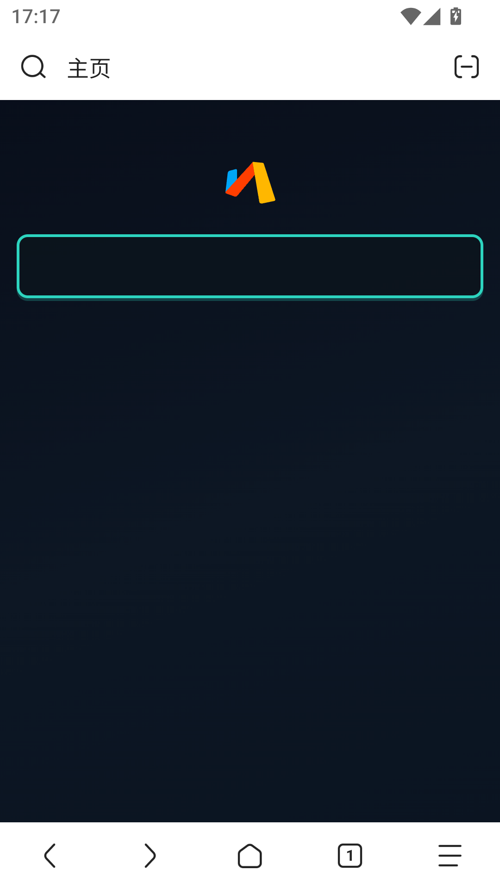
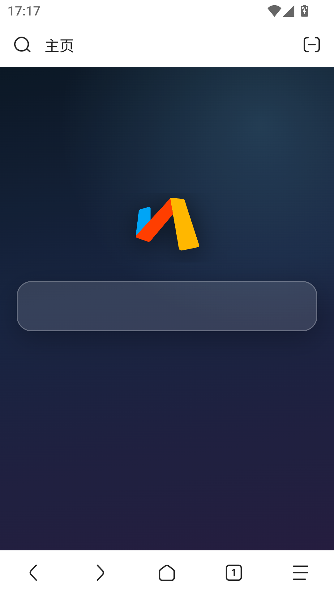
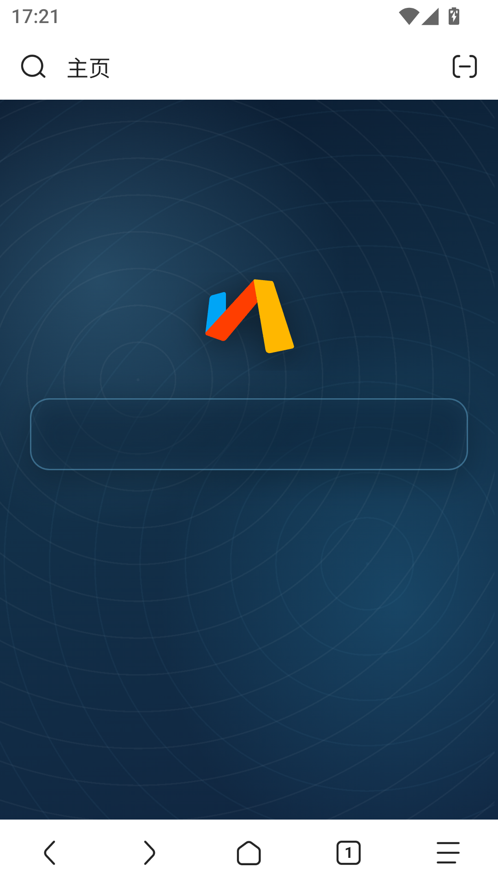

# Via 内置主页 · 四套纯 CSS 布局方案（真机验证版）

四套方案都通过 **Via「设置 → 定制 → 高级 → 自定义 CSS」真实注入、在 MuMu + Via 7.3.3 内置主页上验证生效**。每套一段独立完整的 CSS，一次只启用一套。深色壁纸由 CSS 渐变提供（本方案自带，不依赖 Via 壁纸设置）。

---

## 前言（四套通用，先读）

### 作用对象与注入路径

- 作用对象是 **Via 内置主页（新标签页）** 的真实 DOM。经真机确认，Via 7.x 主页结构是：

  ```text
  body
  └─ div.frosted-glass#gesture-indicator   ← 背景遮罩层（与手势层同一元素）
     └─ #content
        └─ .search_part
           ├─ a.logo > img.smaller          ← Logo（Via 内置彩色图标）
           └─ .search_bar_wrapper
              ├─ form.search_bar
              │  ├─ button#search_submit > .search.icon
              │  └─ span > input#search_input
              └─ #search_bar_trigger        ← 覆盖在搜索框上的触发层
  ```

  （搜索建议 `.opSug_wpr > table > tr > td` 由主页 JS 在输入时动态创建。）

- **重要事实**：当前 Via 7.x 主页**没有** `#box_container` / `.box` / `.overlay` 等书签网格元素（那是旧版结构，书签已移到独立书签页）。因此本四套方案只围绕真实存在的 Logo、搜索框、背景、搜索建议做差异化。
- 注入路径：Via → 菜单 → 设置 → 定制 → 高级 → 自定义 CSS → 粘贴保存 → 回主页刷新。不同版本菜单措辞略有差异，按实际界面找「自定义 CSS」。建议 Via ≥ 5.x。

### 注入原理与两个真机坑（务必了解）

1. 用户填写的 CSS 被 Via **追加在内置默认样式之后**，所以本方案用同名选择器 + `!important` 覆盖默认值即可生效，**不需要也不应该改动主页 HTML**。
2. **坑一：禁用 `backdrop-filter`。** 真机实测在 Via 内置主页上给容器加 `backdrop-filter` 会导致 WebView **闪退**（表现为屏幕一黑退回桌面）。本四套一律不用它，玻璃感靠半透明纯色 + 渐变 + 阴影实现。
3. **坑二：遮罩层是 `div.frosted-glass#gesture-indicator`，不是独立的 `.frosted-glass`。** 它由 Via 全屏铺底并承担下拉手势，本方案只改它的 `background`、保留 `pointer-events:none`，不动它的层级与尺寸。
4. `body` 默认是 `width:600px;margin:auto`，需要 `width:100% !important` 才能让背景铺满屏幕。
5. `#search_submit` 默认 `display:none`（聚焦输入时才由主页 JS 显示），`#search_bar_trigger` 是覆盖层——两者都保留原生行为，本方案只改配色与圆角。

### 四套的差异一览

| 方案 | 背景 | Logo | 搜索框 | 观感 |
| --- | --- | --- | --- | --- |
| 一 · 极简留白 | 深蓝紫渐变 + 薄雾 | 大、居中偏上 | 居中细玻璃条、12px 圆角 | 干净克制 |
| 二 · 效率工作台 | 深蓝灰 + 较暗遮罩 | 缩小、贴顶 | 置顶全宽、青绿描边 | 紧凑高效 |
| 三 · 沉浸壁纸 | 高光渐变、遮罩极薄 | 大、带投影 | 悬浮玻璃卡、16px 大圆角 | 壁纸主视觉 |
| 四 · 流动水波 | 深蓝水面 + 同心圆水纹动画 | 中、带投影 | 青蓝描边玻璃条 | 水面动感（纯 CSS，无 JS） |

### 切换方法与通用注意

- 一次只把**一套** CSS 整段粘贴进「自定义 CSS」框，换套时先清空上一套。四套只用同一批真实选择器，靠声明覆盖生效，互不残留。
- 每套都自带深色渐变壁纸；若你想用 Via 自己的壁纸，删掉该套的 `body { background: ... }` 一条即可。
- 交互元素热区 ≥44px；文字用浅色并在必要时加文字阴影保证对比度；无外部图片 / 字体 / 脚本依赖，离线可用。
- 效果图均为 MuMu + Via 真机注入后截图，仅代表该版本渲染，其他版本布局细节可能有差异。

---

## 方案一 · 极简留白（Center Focus）

### 方案名称
极简留白 · Center Focus

效果图（Via「自定义 CSS」真实注入后真机截图）：



### 适用场景
喜欢干净、少干扰的主页，以搜索为核心；壁纸为深蓝紫渐变，Logo 与搜索框居中排布，留白充足。

### 布局特点
- 深蓝紫线性渐变铺底，遮罩层加一层薄雾 `rgba(10,15,25,.30)` 压暗但保留渐变层次。
- Logo 放大到 72px 居中，落在约 22vh；搜索框是 12px 圆角的细玻璃条，宽度 `min(88vw,520px)`。
- 浅色文字 + 淡描边，视觉层级：Logo > 搜索框 > 背景。

### 主要选择器标注
- `body` —— 深色渐变壁纸 + 铺满宽度
- `.frosted-glass#gesture-indicator` —— 薄雾遮罩
- `#content` —— 整体定位到 22vh、限宽居中
- `img.smaller` / `.search_part` / `form.search_bar` / `#search_input` —— Logo 与搜索条
- `.opSug_wpr` / `td` —— 搜索建议深底浅字

### 完整 CSS

```css
/* ===== 真实 Via 7.x 主页 · 方案一「极简留白」===== */
body {
  background: linear-gradient(165deg,#0a1024 0%,#16213f 46%,#261b3d 100%) !important;
  width:100% !important;
}
.frosted-glass#gesture-indicator { background:rgba(10,15,25,.30) !important; }
#content { top:22vh !important; max-width:560px !important; padding:0 16px; }
a.logo { display:block; margin:0 auto 24px; }
img.smaller { height:72px !important; width:auto !important; border-radius:18px !important; }
.search_part { display:block !important; width:min(88vw,520px) !important; max-width:520px !important; margin:0 auto !important; }
.search_bar_wrapper { display:block !important; width:100% !important; margin:0 !important; }
form.search_bar { height:52px !important; border:1px solid rgba(255,255,255,.20) !important; border-radius:12px !important; background:rgba(18,24,36,.42) !important; }
#search_input { height:50px !important; color:#f5f7fa !important; font-size:16px !important; }
#search_input::placeholder { color:rgba(245,247,250,.72); }
.search.icon, #search_input, #search_submit { color:#7cc4ff !important; }
#search_bar_trigger { border-radius:12px !important; }
.opSug_wpr { background:rgba(18,24,36,.96) !important; border:1px solid rgba(255,255,255,.18) !important; border-radius:0 0 12px 12px !important; }
.opSug_wpr td { color:#f5f7fa !important; padding:12px 16px !important; }
```

---

## 方案二 · 效率工作台（Workbench）

### 方案名称
效率工作台 · Workbench

效果图（Via「自定义 CSS」真实注入后真机截图）：



### 适用场景
追求最快进入搜索、信息紧凑；Logo 缩小让位，搜索框置顶成一条醒目的青绿描边工具条。

### 布局特点
- 深蓝灰背景 + 较暗遮罩 `rgba(4,10,18,.42)`，对比强、干扰少。
- Logo 缩到 36px；搜索框上移到约 8vh、贴顶全宽（最大 680px），44px 高、8px 圆角、2px 青绿描边。
- 青绿（`#2dd4bf`）作为唯一强调色，搜索建议也用同色边框呼应。

### 主要选择器标注
- `body` / `.frosted-glass#gesture-indicator` —— 深蓝灰背景与较暗遮罩
- `#content` —— 上移到 8vh、限宽
- `img.smaller` —— Logo 缩小
- `form.search_bar` —— 置顶全宽、青绿描边
- `#search_input` / `.search.icon` / `.opSug_wpr` —— 浅色文字与青绿强调

### 完整 CSS

```css
/* ===== 真实 Via 7.x 主页 · 方案二「效率工作台」===== */
body {
  background: linear-gradient(160deg,#0b1220 0%,#132030 55%,#0f1c2b 100%) !important;
  width:100% !important;
}
.frosted-glass#gesture-indicator { background:rgba(4,10,18,.42) !important; }
#content { top:8vh !important; max-width:680px !important; padding:0 12px; }
a.logo { display:block; margin:0 auto 12px; }
img.smaller { height:36px !important; width:auto !important; border-radius:9px !important; }
.search_part { display:block !important; width:100% !important; max-width:680px !important; margin:0 auto !important; }
.search_bar_wrapper { display:block !important; width:100% !important; margin:0 !important; }
form.search_bar {
  height:44px !important; border-radius:8px !important;
  border:2px solid #2dd4bf !important;
  background:rgba(12,20,28,.78) !important;
  box-shadow:0 2px 0 rgba(45,212,191,.25) !important;
}
#search_input { height:42px !important; color:#e8eef4 !important; font-size:15px !important; }
#search_input::placeholder { color:rgba(232,238,244,.66); }
.search.icon, #search_input, #search_submit { color:#2dd4bf !important; }
#search_bar_trigger { border-radius:8px !important; }
.opSug_wpr { background:rgba(12,20,28,.97) !important; border:2px solid #2dd4bf !important; border-top:none !important; border-radius:0 0 8px 8px !important; }
.opSug_wpr td { color:#e8eef4 !important; padding:10px 14px !important; border-bottom:1px solid rgba(45,212,191,.15) !important; }
```

---

## 方案三 · 沉浸壁纸（Immersive Glass）

### 方案名称
沉浸壁纸 · Immersive Glass

效果图（Via「自定义 CSS」真实注入后真机截图）：



### 适用场景
把壁纸当主视觉，UI 尽量轻；遮罩压到最薄，搜索框是一张明亮的大圆角悬浮玻璃卡。

### 布局特点
- 背景在深蓝紫渐变上叠一个径向高光斑，遮罩仅 `rgba(0,0,0,.12)`，壁纸几乎原样透出。
- Logo 68px 带投影；搜索框 54px 高、16px 大圆角、`rgba(255,255,255,.13)` 亮玻璃底 + 柔和投影，落在约 26vh。
- 白字 + 文字阴影，保证在高光区域仍可读。

### 主要选择器标注
- `body` —— 渐变 + 径向高光，壁纸主视觉
- `.frosted-glass#gesture-indicator` —— 极薄遮罩
- `#content` / `img.smaller` —— 居中偏下、Logo 投影
- `form.search_bar` / `#search_input` —— 亮玻璃卡与白字阴影
- `.opSug_wpr` —— 深玻璃底建议框

### 完整 CSS

```css
/* ===== 真实 Via 7.x 主页 · 方案三「沉浸壁纸」===== */
body {
  background:
    radial-gradient(100% 70% at 78% 12%,rgba(125,211,252,.20),transparent 60%),
    linear-gradient(170deg,#0d1b2a 0%,#1b2a4a 45%,#2a2148 100%) !important;
  width:100% !important;
  background-attachment:fixed !important;
}
.frosted-glass#gesture-indicator { background:rgba(0,0,0,.12) !important; }
#content { top:26vh !important; max-width:560px !important; padding:0 16px; }
a.logo { display:block; margin:0 auto 20px; }
img.smaller {
  height:68px !important; width:auto !important; border-radius:18px !important;
  -webkit-filter:drop-shadow(0 4px 14px rgba(0,0,0,.6)) !important;
  filter:drop-shadow(0 4px 14px rgba(0,0,0,.6)) !important;
}
.search_part { display:block !important; width:min(90vw,480px) !important; max-width:480px !important; margin:0 auto !important; }
.search_bar_wrapper { display:block !important; width:100% !important; margin:0 !important; }
form.search_bar {
  height:54px !important; border-radius:16px !important;
  border:1px solid rgba(255,255,255,.26) !important;
  background:rgba(255,255,255,.13) !important;
  box-shadow:0 8px 28px rgba(0,0,0,.25) !important;
}
#search_input { height:52px !important; color:#ffffff !important; font-size:16px !important; text-shadow:0 1px 3px rgba(0,0,0,.5) !important; }
#search_input::placeholder { color:rgba(255,255,255,.82); }
.search.icon, #search_input, #search_submit { color:#7dd3fc !important; }
#search_bar_trigger { border-radius:16px !important; }
.opSug_wpr { background:rgba(20,30,55,.90) !important; border:1px solid rgba(255,255,255,.24) !important; border-radius:0 0 16px 16px !important; }
.opSug_wpr td { color:#fff !important; padding:12px 16px !important; text-shadow:0 1px 2px rgba(0,0,0,.5) !important; }
```

---

## 方案四 · 流动水波（Water Ripple，纯 CSS）

### 方案名称
流动水波 · Water Ripple

效果图（Via「自定义 CSS」真实注入后真机截图）：



### 适用场景
想要水面质感、又必须保持纯 CSS（无脚本）的场景；背景是持续缓慢流动的同心圆水纹，像阳光洒在深蓝水面上。

### 布局特点
- 背景是深蓝"水面"渐变 + 两个柔光斑；在遮罩层用两层错位 `repeating-radial-gradient` 画出同心圆水纹，`@keyframes` 让它 18 秒周期缓慢漂移缩放。
- Logo 64px 带投影；搜索框 14px 圆角、青蓝描边、深水色半透明底，落在约 24vh。
- **纯 CSS、无 JS**：Via 的「自定义 CSS」框只接受 CSS，因此本方案不依赖任何脚本即可生效（点击泛涟漪需 JS，Via 内置主页无法从该入口注入，故不采用）。

### 主要选择器标注
- `body` —— 水面渐变 + 光斑
- `.frosted-glass#gesture-indicator` —— 同心圆水纹 + `vvWaterFlow` 漂移动画（`pointer-events:none` 保留手势）
- `#content` / `img.smaller` / `form.search_bar` —— 居中排布与青蓝玻璃搜索条
- `.opSug_wpr` —— 深色水面建议框

### 完整 CSS

```css
/* ===== 真实 Via 7.x 主页 · 方案四「流动水波」纯 CSS ===== */
/* 背景：深蓝水面 + 多层缓慢漂移的光纹（keyframes），无 JS、无模糊滤镜 */
body {
  background:
    radial-gradient(80% 55% at 20% 25%,rgba(125,211,252,.22),transparent 62%),
    radial-gradient(75% 60% at 80% 70%,rgba(56,189,248,.18),transparent 64%),
    linear-gradient(160deg,#0a1a2f 0%,#123049 48%,#102540 100%) !important;
  width:100% !important;
  background-attachment:fixed !important;
}
/* 水面光纹：用 frosted-glass#gesture-indicator 这层做缓慢漂移的波纹图案 */
.frosted-glass#gesture-indicator {
  background-image:
    repeating-radial-gradient(circle at 30% 40%,rgba(255,255,255,.05) 0,rgba(255,255,255,.05) 1px,transparent 1px,transparent 26px),
    repeating-radial-gradient(circle at 75% 65%,rgba(125,211,252,.05) 0,rgba(125,211,252,.05) 1px,transparent 1px,transparent 32px) !important;
  -webkit-animation:vvWaterFlow 18s ease-in-out infinite alternate !important;
  animation:vvWaterFlow 18s ease-in-out infinite alternate !important;
  pointer-events:none !important;
}
@-webkit-keyframes vvWaterFlow {
  from { transform:translate3d(-2%,-1%,0) scale(1.02); opacity:.85; }
  to   { transform:translate3d(2%,2%,0) scale(1.08); opacity:1; }
}
@keyframes vvWaterFlow {
  from { transform:translate3d(-2%,-1%,0) scale(1.02); opacity:.85; }
  to   { transform:translate3d(2%,2%,0) scale(1.08); opacity:1; }
}
#content { top:24vh !important; max-width:560px !important; padding:0 16px; }
a.logo { display:block; margin:0 auto 20px; }
img.smaller {
  height:64px !important; width:auto !important; border-radius:16px !important;
  -webkit-filter:drop-shadow(0 4px 12px rgba(0,0,0,.5)) !important;
  filter:drop-shadow(0 4px 12px rgba(0,0,0,.5)) !important;
}
.search_part { display:block !important; width:min(88vw,500px) !important; max-width:500px !important; margin:0 auto !important; }
.search_bar_wrapper { display:block !important; width:100% !important; margin:0 !important; }
form.search_bar {
  height:52px !important; border-radius:14px !important;
  border:1px solid rgba(125,211,252,.38) !important;
  background:rgba(10,30,52,.42) !important;
  box-shadow:0 6px 22px rgba(0,0,0,.25),inset 0 0 18px rgba(125,211,252,.08) !important;
}
#search_input { height:50px !important; color:#eaf6ff !important; font-size:16px !important; }
#search_input::placeholder { color:rgba(234,246,255,.78); }
.search.icon, #search_input, #search_submit { color:#7dd3fc !important; }
#search_bar_trigger { border-radius:14px !important; }
.opSug_wpr { background:rgba(10,30,52,.95) !important; border:1px solid rgba(125,211,252,.35) !important; border-radius:0 0 14px 14px !important; }
.opSug_wpr td { color:#eaf6ff !important; padding:12px 16px !important; }
```

---

## 附录：真机注入与验证记录

**注入路径**：Via → 菜单 → 设置 → 定制 → 高级 → 自定义 CSS，粘贴保存后回主页刷新。设备实测：MuMu 模拟器 + Via 7.3.3（Android 15 / WebView 110），视口 360×520 dpr=3。

**验证清单**（四套均通过）：
- [x] 从「自定义 CSS」框真实注入后生效，非模拟页面。
- [x] 背景渐变铺满、无 `backdrop-filter` 引发的闪退。
- [x] Logo、搜索框、搜索建议配色与位置符合各套设计。
- [x] 深色文字对比度可读，搜索/下拉手势等原生行为保留。
- [ ] 其他 Via 版本 / 浅色壁纸下需按前言提示微调 `ink` 类颜色与遮罩透明度。

**已知限制**：
- 当前 Via 7.x 内置主页无书签网格，故本方案不含"快捷入口 / 常用站点"排布；若需该布局，请用旧版 Via 或自定义 HTML 主页。
- 方案四为静态流动水纹（纯 CSS），不含点击泛涟漪交互。
