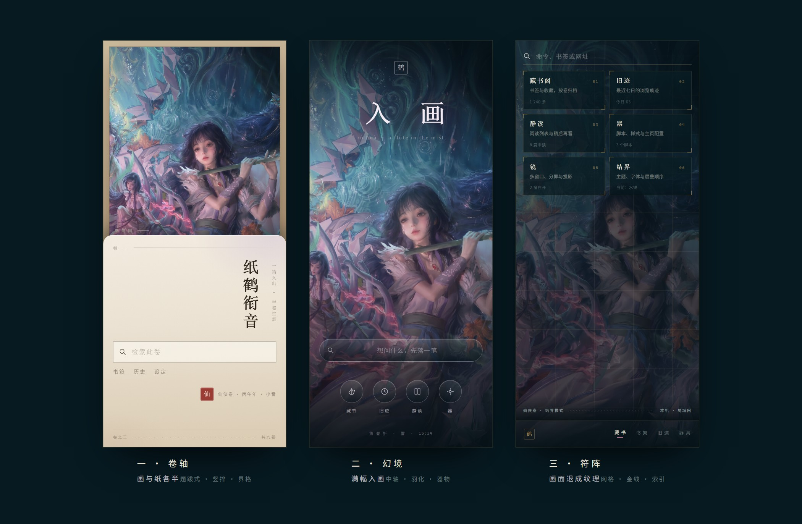
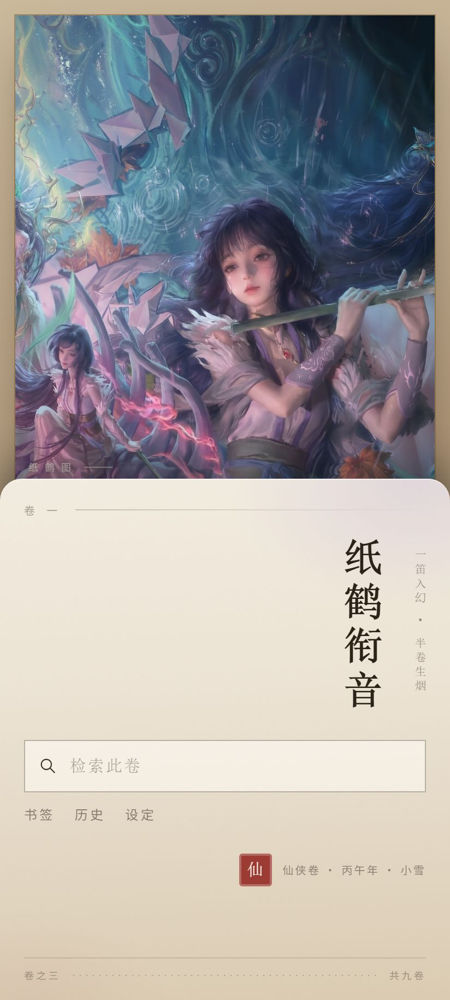
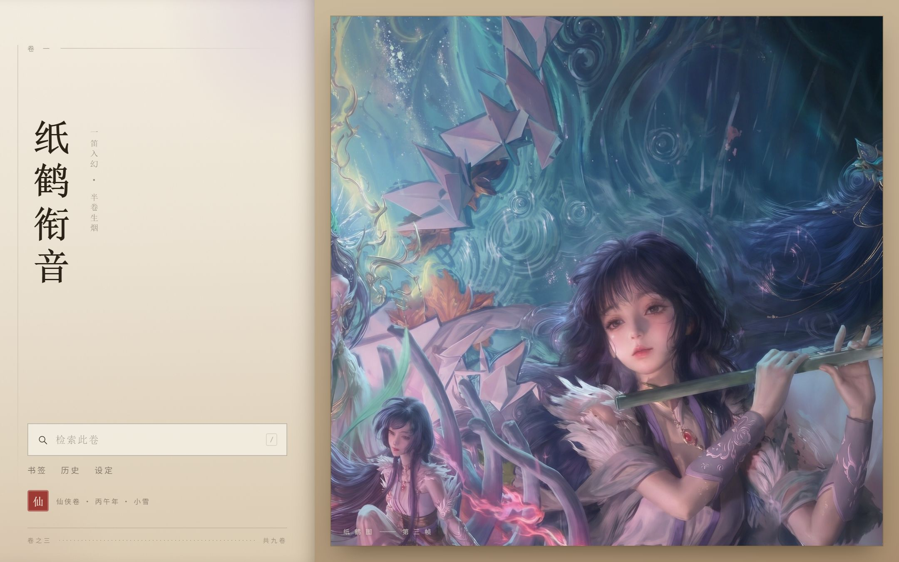
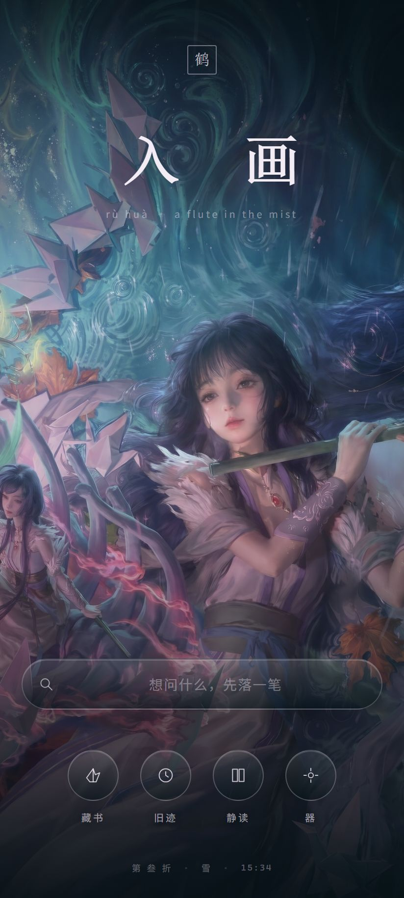
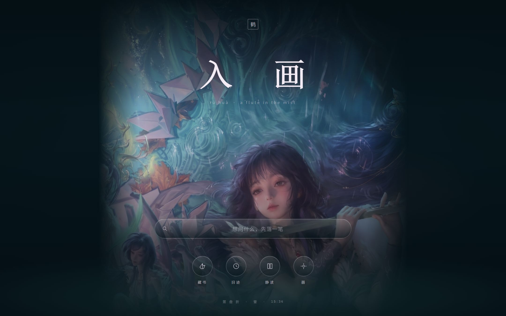
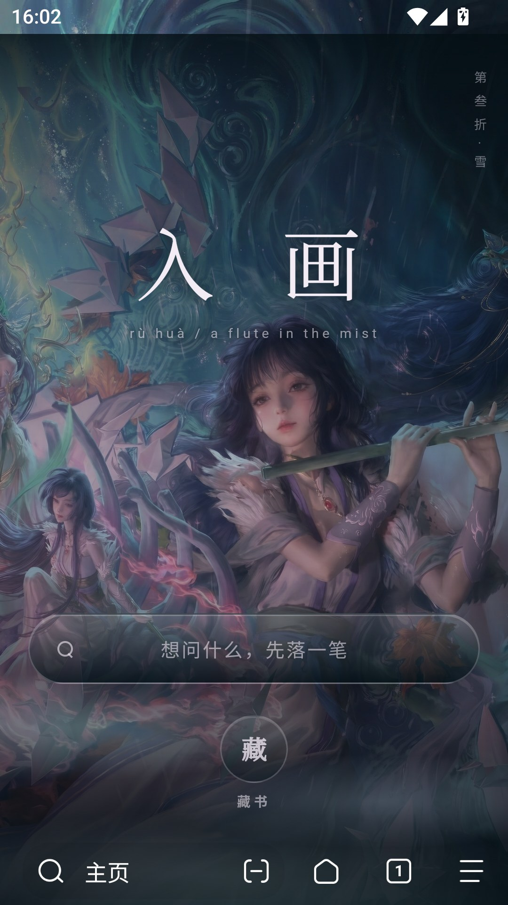
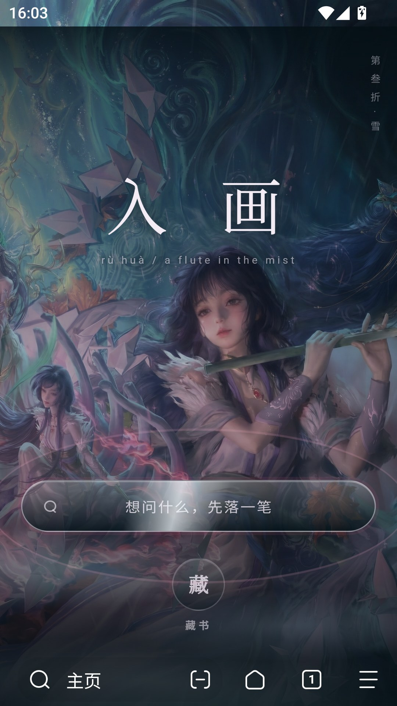
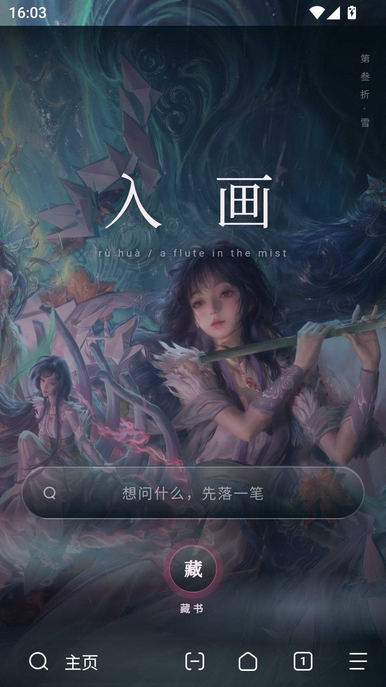
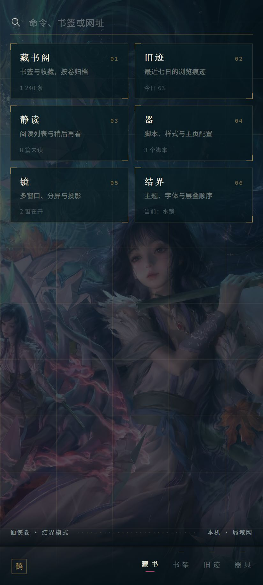
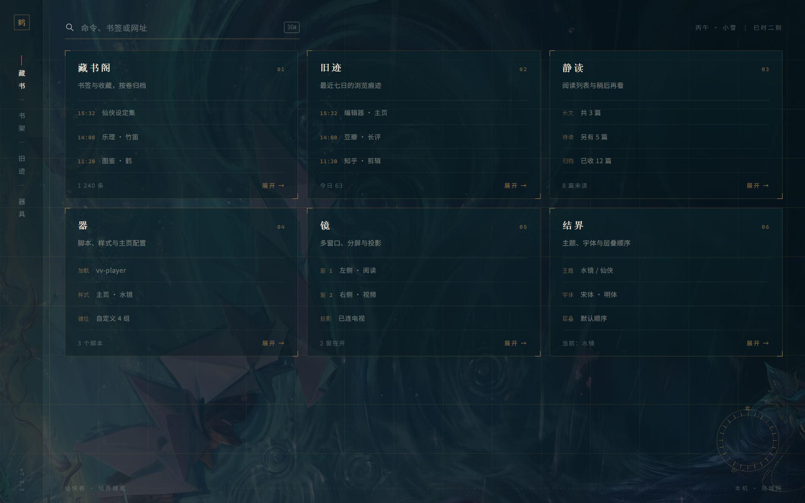

# 仙侠主页 · 三个方向（手机 Via 主页）

> 归属 `via-home-ui/`，与仓库根目录的播放器插件互不引用。
> 姊妹文档：`VIA_HOME_UI_SCHEMES.md`（四套常规方案）、`VIA_HOME_UI_SCHEME_XIANXIA.md`（水镜结界）。
>
> 本文基于用户提供的一张插画（1152×2048，吹笛少女 / 青绿漩涡 / 纸鹤 / 胭脂灵气丝）做三个**结构不同**的方向，
> 主画布是**手机竖屏 412×915**；桌面与平板只作为延展，不反过来倒推手机。



---

## 0. 先说清边界，再谈风格

Via 手机主页的 DOM 只有一个 Logo 和一条搜索框（`a.logo` + `.search_bar_wrapper`），
自定义 CSS 是**追加**到 `files/homepage.css` 之后，不能改结构、不能引脚本。

所以三个方向都拆成两层，哪层能落地写在明处：

| 层 | 内容 | 能不能纯 CSS 做 |
| --- | --- | --- |
| **氛围层** | 背景取景、纸面/雾/纹理、渐变、蒙版、装饰线、竖排标题文案 | 能。伪元素 + `content` + 渐变，已经在水镜那版验证过 |
| **控件层** | 搜索条换皮、Logo 换位、焦点态、按下涟漪 | 能。选择器就那几个（见 §6） |
| **模块层** | 纸鹤入口、六格结界卡、左侧工具轨 | **不能**。这些要真节点，纯 CSS 只能画个假壳；要么走 HTML 替换版主页，要么借 Via 原生菜单/书签页 |

下面的视觉稿把模块层也画出来了，是为了让方向可判断；文末会标清每一块归属哪一层。

---

## 1. 背景图怎么读

取色是对原图做的区域平均（5×9 网格），不是肉眼估的：

| 取样 | 色值 | 在画面里的位置 |
| --- | --- | --- |
| 墨底 | `#121C26` | 右上最深处的漩涡芯 |
| 夜蓝 | `#23334F` | 天空大面积底色 |
| 雾蓝 | `#2E4558` | 中景漩涡的过渡 |
| 青玉 | `#5E93A4` | 漩涡高光、笛身冷光 |
| 麦白 | `#C6CCB4` | 左侧透进来的那束天光 |
| 藕荷 | `#BCA6C0` | 衣袍与纸鹤的受光面 |
| 胭脂 | `#A86380` | 绕身的灵气丝、唇色 |
| 赭石 | `#85524F` | 右下枫叶 |

三个可以直接借来当"设计语法"的东西：

1. **大雾区**——画面右上和中景有大片低对比区域，天然适合放标题和留白，不用额外压暗。
2. **曲线**——灵气丝是画面里唯一的"动"，所以三个方向的交互都该是"扩散/飘移"，不是"缩放/弹跳"。
3. **重复**——纸鹤是成阵列出现的，可以当"多个同类入口"的视觉母题（方案二的入口就用了它）。

情绪关键词：**冷、空、易碎、有声音**。所以三版都不该出现高饱和大色块、圆润卡通图标、亮色按钮。

---

## 2. 方案一 · 卷轴

> **一句话**：上半是画心，下半是一张纸；主页不是"网页"，是一幅还没题完的立轴。

### 2.1 主题

「一纸长卷」。画面被一条硬边界切成**画**与**纸**——上半是那幅插画（装裱在绢边上），
下半是一整片米色纸面，标题竖排写在纸上，搜索框是一条细边方框，落款是红印。

### 2.2 页面结构（412×915）

```
┌──────────────────────────────┐
│ 绢边 14px                    │   0
│  ┌────────────────────────┐  │
│  │                        │  │
│  │         画 心          │  │
│  │    cover / 50% 30%     │  │
│  └────────────────────────┘  │
├──────────────────────────────┤   ← 纸面圆角 20px，向上压 20px
│ 卷 一 ───────────────────────│
│                     纸       │
│                     鹤       │   竖排标题 36px
│                     衔       │
│                     音       │
│                              │
│  ┌────────────────────────┐  │
│  │搜  检索此卷           /│  │   48px 方框描边
│  └────────────────────────┘  │
│  书签   历史   设定          │
│        印  仙侠卷 - 丙午年   │   落款右对齐
│                              │
│ 卷之三 -------------- 共九卷 │   915
└──────────────────────────────┘
```

数值：画心 `50vh`；纸面 `50vh + 20px`（负 margin 压住画心）；左右内边距 `22px`；
标题竖排 `36px / 字距 .12em`；搜索框 `48px`、圆角 `0`；落款印章 `30px`。



### 2.3 视觉风格

- **有框**。画心四边是绢色（`#CBB99C`），内侧一道 1px 金褐线，这是和另外两版最直接的分界——
  另外两版都没有"实体边界"。
- **纸是真的纸**：三层叠加——藕荷色由右上角渗入、暖褐在左下角沉、最上面一层 SVG 噪点（`opacity .055` + `multiply`）做纸纤维。
- **竖排**。标题、副题都是 `writing-mode: vertical-rl`，左侧一条界格竖线从眉题贯到卷尾（桌面版贯到底，手机版省略以免挤）。
- **余白落在下方**。标题、搜索、导航、落款四段成组靠上，剩下的空白留在卷尾线以上——这是题跋的自然读法，不是"没排满"。

### 2.4 色彩与字体

| 角色 | 值 |
| --- | --- |
| 纸（亮 → 暗） | `#F4EDE1` → `#EDE4D5` → `#DCCDB4` |
| 字（墨） | `#332A20`，次级 `rgba(51,42,32,.5)` |
| 印（朱） | `#9C3B34` |
| 绢边 | `#CBB99C`，内线 `rgba(122,92,50,.5)` |

字体：标题 `"Source Han Serif SC","Noto Serif CJK SC","Songti SC",SimSun,serif` 600；
搜索框内文也用宋体（`16px / 字距 .1em`）——这一版里所有文字都是衬线，是唯一的"全衬线"方案。

### 2.5 核心内容模块

| 模块 | 层 | 说明 |
| --- | --- | --- |
| 画心 | 氛围 | 背景图 `cover`，焦点 `50% 30%`，包在绢边里 |
| 竖排标题 + 副题 | 氛围 | `#content::after` 的 `content` 就能写，不需要节点 |
| 搜索条 | 控件 | 方框描边，焦点态描边转朱 `rgba(155,59,52,.65)` |
| 三枚文字入口 | 模块 | 书签 / 历史 / 设定（纯 CSS 只能画不可点，需真链接） |
| 落款印章 | 氛围 | 朱底白字 + 日期，右下对齐 |

### 2.6 适用场景

想要**作品感**、把主页当"入口扉页"而不是"工具台"的人；阅读型、收藏型用户；
桌面/平板也会打开同一套样式的人（这一版横屏最不吃亏，见 2.7）。

### 2.7 响应式

- **≥900px（横屏/平板）**：改成左右分栏——左 36%（`clamp(430px,35vw,560px)`）纸面，右侧画心。
  画心 `inset 26px` 装裱，右下角一行 10px 题注「纸 鹤 图 · 第 三 帧」。标题回到竖排但整体上移到视觉中心。
- **<760px**：就是上面那张图，画上字下。
- 触控：搜索框 48px（≥44px）、印章 30px 外再包 14px 热区、导航文字行高 ≥44px。



### 2.8 落地要点

- 画心与纸面分两层画：画心用 `#gesture-indicator::before`（`position: fixed; height: 50vh; background: cover`），
  纸面用 `#content`（`top: auto; bottom: 0; height: calc(50vh + 20px); border-radius: 20px 20px 0 0`）。
- 纸的噪点用 `data:` 内联 SVG `feTurbulence`，别引外链图片。
- 圆角纸面要压住画心 20px，否则中间会露一条背景色缝。

### 2.9 风险

纸面占了半屏，搜索框能用的宽度只剩 `412 - 44`；如果 Via 的软键盘把 `#content` 顶起来，
纸面会跟着上移——这一版对"键盘顶起"最敏感，需要真机确认。

---

## 3. 方案二 · 幻境

> **一句话**：没有界面，只有一张画；所有控件都浮在雾里，像画上刚落下的几笔。

### 3.1 主题

「入画」。插画满幅铺满整屏，不做边框、不做卡片；一条**中轴**从上到下：小印 → 大字 → 搜索 → 四枚纸鹤入口 → 折次。
画面本身是主角，UI 是"画上的题字"。

### 3.2 页面结构（412×915）

```
┌──────────────────────────────┐
│                              │
│         入        画         │
│     rù huà / a flute...      │
│                              │
│       （人物面部留空）       │
│                              │
│  ┌────────────────────────┐  │
│  │搜  想问什么，先落一笔  │  │
│  └────────────────────────┘  │
│           （ 藏 ）           │
│             藏书             │
└──────────────────────────────┘
```

关键节奏：**标题占上 1/3，器物压在下 1/4，中间 40% 完全空出来给人像**。
这是这一版唯一的排布规则，也是它和另外两版最大的差别——另外两版都在"填"，这一版在"让"。



### 3.3 视觉风格

- **无边界**：没有框、没有卡片、没有分割线。所有控件是低透明度的薄片（`rgba(239,245,244,.10)` → `rgba(4,18,24,.62)` 的竖向渐变 + 1px 内高光）。
- **上下被雾吃掉**：顶部 0→13% 从 `rgba(4,15,20,.72)` 渐隐到全透明，底部 78%→100% 再压回 `.90`。
  这样状态栏和底部手势区不会和画面打架。
- **不用 `backdrop-filter`**。Via 的 WebView 110 上它会闪退；通透感全靠"叠色 + 内高光"伪造。
- 动效只做**呼吸**：纸鹤圆环 3s 极慢的 `opacity` 起伏，不做位移。

### 3.4 色彩与字体

| 角色 | 值 |
| --- | --- |
| 雾底 | `#040F14` |
| 主字 | `#F4ECF4`（藕荷白，不是纯白） |
| 次级字 | `rgba(239,231,241,.44)` |
| 描边 | `rgba(239,231,241,.22)` |
| 强调（仅 hover） | `#D9557F` |

字体：标题宋体 600 挤到极限（`58px / 字距 .3em`，靠 `margin-right:-.3em` 修正光学居中）；
副题用**小号无衬线全小写**（`rù huà · a flute in the mist`）——中文大字 + 拉丁小字的反差是这一版的字体性格。

### 3.5 核心内容模块

| 模块 | 层 | 说明 |
| --- | --- | --- |
| 满幅画心 | 氛围 | 手机端直接 `100% 100% / cover`，不做蒙版 |
| 小印 | 氛围 | 30px 描边方框 + 单字「鹤」，`content` 可写 |
| 主标题 + 拼音副题 | 氛围 | 同上，纯 CSS 可写 |
| 搜索条 | 控件 | 胶囊、半透明、居中占位文字 |
| 四枚纸鹤入口 | 模块 | 52px 圆形 + 线性图标；纯 CSS 只能画壳。落地版收敛为一枚真实链接「藏」 |
| 折次状态 | 氛围 | 「第 叁 折 · 雪」+ 时间 |

### 3.6 适用场景

手机为主、几乎不在桌面打开主页的人；想要"打开即入境"的沉浸感；
愿意接受"这一屏不承担功能，只承担情绪"的人。

### 3.7 响应式

- **≥900px**：画心收成 `min(64vw,880px)` 的竖屏，左右两侧交给雾（`mask-image` 只做左右羽化，上下交给渐隐），
  读起来是"屏风"而不是"椭圆聚光"——早期版本用径向蒙版，边缘会露一圈假光，已改掉。
  标题放大到 `clamp(62px,6.6vw,102px)`，器物横排四枚，间距 `38px`。
- **<760px**：画心满幅，器物降为 52px。
- 触控：圆形入口 52px、搜索条 52px；圆形入口之间留 22px，避免误触。
- **避让**：所有控件都压在人物胸部以下（62% 之后），面部区域一件东西都不放。



### 3.8 落地要点

- 取景 `background-position: 50% 20%`：再往上人物会顶到标题，再往下下巴会被搜索条切。
- 顶部渐隐的停止点要落在 13%~15%，否则状态栏文字（系统绘制）会看不清。
- 四枚入口如果是"纯 CSS"，只能画四个圆，点不动；要么改成三个真链接（书签/历史/设置），要么这一版就只留搜索。

### 3.9 风险

画面信息量大，标题压在漩涡纹理上，可读性全靠白色 + 外发光 + 一层压暗；
如果用户换成一张更亮的壁纸，只要 `--hj-veil` 保持默认（1），字仍压得住，
但**画面的层次会整体变灰**——这一版本质还是深色主题（见 3.10 的壁纸方案）。

### 3.10 已实现（真机，2026-11-23 / 壁纸方案 2026-11-26 重构）

落地文件：`home-huanjing.css`（484 行）+ `assets/huanjing-bg.jpg`（1080×1920，265 KB，示例壁纸）。

**安装走 Via 自己的入口，不直接替换主页文件**：设置 → 定制 → 高级 → 自定义 CSS，把整段粘进去保存。
Via 的机制是「默认 CSS（本机 5661 字节）+ 自定义 CSS」拼接后重写 `files/homepage.css`。
每次重写都从默认段开始，不会累积；Via 会把自定义部分的换行存成 CRLF，所以文件实际字节会比两段相加多约 470（正常）。
自定义部分另存在 `shared_prefs/settings.xml` 的 `csstheme`（base64 明文）。
所以两条等价：在 UI 里粘贴，或把 `默认 + 本样式` 写进 `homepage.css` 并把同样内容 base64 写进 `csstheme`
（两边必须一致，否则进一次「定制」页就会按旧的 `csstheme` 把 `homepage.css` 回写、样式被回滚）。

#### 壁纸：归 Via 的「设置 → 定制 → 背景」管，CSS 不自带

早期版本把 `assets/huanjing-bg.jpg` 写进 CSS 的 `background` 里，结果是**用户在「背景」里换任何壁纸都不生效**——
页面自己铺了一张不透明底图，把原生壁纸整块盖住（真机只在上方状态栏露出几像素）。
现在改成：`html / body / #gesture-indicator` 全部 `background:transparent`，
壁纸由 Via 画在 WebView 之下（原生层），换图 / 换预设色 / 拖动「不透明度」立刻反映到主页，**不需要重启**（真机实测）。

代价是「字可能糊在亮底上」，所以留了一层可调压暗：`#gesture-indicator::before` 的渐变
（`--hj-veil-ink` 定色、`--hj-veil` 定强度，默认 1），顶部与底部厚、中间薄。
壁纸偏亮或用户把「不透明度」拉到 30%+（壁纸会被主题色洗白）时，这层是白字的底线；
想要更「纯壁纸」可以把 `--hj-veil` 调到 `0.6~0.8`，代价是小字对比度下降。

- 示例壁纸怎么用：把 `assets/huanjing-bg.jpg` 传到手机相册，在「定制 → 背景 → 图片」里选它（不用再放 `files/assets/`）。
- Via 用 `cover` 裁切，1080×1920 的图放进主页可视区会被裁得比设计稿更近（人物更大），这是 Via 的渲染方式，CSS 改不了。
- 「背景」面板的三个值：`图片/预设色`、`主题色 亮色/暗色`、`不透明度 0%~`。
  不透明度越高，壁纸越往主题色（亮色=白）洗，0% 才是原图。
- 命令行部署（真机回归用）必须**同时**写 `homepage.css` 与 `settings.xml` 的 `csstheme`，只写前者会在进「定制」时被回滚。





**顶部那条 `🔍 主页` 是 Via 自己的地址栏**，不是网页元素——CSS 注入只能改 `homepage2.html` 里的东西，
碰不到浏览器的 chrome。要去掉它得在 Via 设置里关（外观 / 工具栏），与这份样式无关。

真机环境：MuMu / Via 7.3.3 / WebView 110 / 1080×1920 @480dpi（CSS 视口 360×约 521，
Via 工具栏与系统导航各占一条，所以纵向比设计稿矮，间距全部由底部起算而不是按 vh 均分）。

**与设计稿的三处收敛**（都是「纯 CSS 造不出可点节点」的代价）：

1. 顶部「鹤」小印去掉，顶部改由标题承担第一眼；
2. 四枚纸鹤入口收敛成**一枚「藏」圆印**——复用真实 `a.logo` 链接（点开书签），是页面上唯一可点入口；
3. 底部「折次」移到右上竖排，且**没有实时时间**（纯 CSS 拿不到时钟，写死的时间就是假信息）。

**点击反馈**（两个可点元素都给了，避免「按了没反应」）：

| 元素 | 状态变化 | 动效 |
| --- | --- | --- |
| 搜索条 | 描边提亮、底色压深、提示语转亮、轻微下压 | 两圈椭圆水波错开荡开（内圈近白 0.90s / 外圈胭脂 1.15s 延迟 0.2s）+ 条内水光按 1.9s 循环流过（按住期间一直在流） |
| 「藏」圆印 | 缩到 0.94、字转白、标签提亮 | 胭脂外扩光晕，走 `transition` 回弹 |

另外背景常驻一层 `hjFlow`（14s）：水面高度上的几道青白光带缓慢横移，让静止的插画也有「水在动」的呼吸。

**调试坑（比代码坑更花时间）**：用 `adb shell am start -n mark.via/mark.via.Shell` 启动 Via
会新开一个空标签盖住主页，看起来就是「主页白屏」；而且这个空标签会被复用到之后的每次启动。
**真机调试一律用 launcher 启动**（`monkey -p mark.via -c android.intent.category.LAUNCHER 1` 或点桌面图标）。
排查时走过一圈弯路：换主页 HTML → 清 WebView 缓存 → 重启模拟器全都无效，最后 `pm clear mark.via` 才复位。

**四个代码坑**（都是真机上才会暴露的，已写进代码注释）：

1. **涟漪必须挂在 `#search_bar_trigger` 的伪元素上**。挂 `.search_bar_wrapper` 会被 `form.search_bar`
   的实底背景整片盖住——真机上只看得见露出条外的 10px，看起来像「条子描边变粗」而不是水波。
2. **别给伪元素同时挂 `filter:blur()` 和 `animation`**。WebView 110 上整层不渲染，本地 Chromium 却是正常的。
   柔边改用多层 `box-shadow`。
3. **`#content` 的 inline opacity 会把涟漪一起淡掉**。Via 的 trigger 点击会把 `#content` 内联设成
   `opacity:.1 + translateY(72px)`，120ms 后才跳搜索；不压住 opacity，水波刚起就没了。
   落地用 `#content{opacity:1 !important}`——代价是 Via 原来那记「整页淡出」的过场没有了。
4. **别用 `:focus-within` 驱动涟漪**：触发层是 `<button>`，点完会保留焦点，涟漪会一直挂在页面上。只认 `:active`。

涟漪的基点 `transform` 要直接写成「扩散之后」的形貌，关键帧被移除时才不会往外跳一下。

---

## 4. 方案三 · 符阵

> **一句话**：把画退成底纹，上面铺一张克制的网格；国风留在材质里，秩序留在版式里。

### 4.1 主题

「结界」。插画被压到 20%~32% 不透明度当纹理（桌面只取画面上部——漩涡与纸鹤，避开人脸），
上面是 88px 栅格线、金线描边的六格「结界卡」、顶部一条命令栏、底部一条工具栏。
唯一还"仙"的地方是材质与金线，版式是彻底的现代工具。

### 4.2 页面结构（412×915）

```
┌──────────────────────────────┐
│ 搜  命令、书签或网址         │   38px 仅下边线
├──────────────────────────────┤
│ ┌───────────┐ ┌───────────┐  │
│ │ 藏书阁  01│ │ 旧迹    02│  │   六格 2x3
│ │ 1 240 条  │ │ 今日 63   │  │
│ └───────────┘ └───────────┘  │
│ ┌───────────┐ ┌───────────┐  │
│ │ 静读    03│ │ 器      04│  │
│ └───────────┘ └───────────┘  │
│ ┌───────────┐ ┌───────────┐  │
│ │ 镜      05│ │ 结界    06│  │
│ └───────────┘ └───────────┘  │
│                              │
│        （画面露出来）        │   这 45% 留给人像
│                              │
│ 仙侠卷 / 结界模式 / 本机     │
├──────────────────────────────┤
│ 印  藏书  书架  旧迹  器具   │   60px dock
└──────────────────────────────┘
```

数值：卡片 `padding 13px 14px`、间距 `10px`、圆角 `0`（直角是这一版的性格）；
序号 `01–06` 用等宽字体；底部 dock `60px`；卡片下方留 `45%` 不平铺。



### 4.3 视觉风格

- **直角 + 金线**。所有容器 `border-radius: 0`，1px `rgba(201,162,92,.16)` 描边；
  每格只有**对角两个** 9px 刻痕（`::before` 左上、`::after` 右下），不是四角全包——四角全包会像"复古票券"，两角才像"刻记"。
- **网纹可见但不抢字**：`repeating-linear-gradient` 88px 栅格，透明度 `.105 / .085`，上下用 mask 渐隐。
- **画面分层**：取景停点桌面 `50% 0%`（只露漩涡与纸鹤，人脸不入画）、手机 `50% 18%`（把人物带回来）；
  权重桌面 `.26`、手机 `.32`——手机上画面是被"看"的，被压太重就白压了。
  手机端卡片底色要加深到 `.80 → .68`，否则描边压在亮部会糊。
- 这一版是唯一有**信息层级**的：命令栏 > 卡片标题 > 描述 > 元信息（`10px` 金褐 / `12px` 灰）。

### 4.4 色彩与字体

| 角色 | 值 |
| --- | --- |
| 底 | `#06161C`（叠 `rgba(5,19,25,.84→.985)` 压暗） |
| 卡面 | `rgba(11,36,43,.62)` → `rgba(7,24,30,.46)` |
| 金线 | `#C9A25C`（描边 `.16`、序号 `.5`、hover `.42`） |
| 主字 | `#EDE6DA` |
| 描述 | `rgba(232,227,217,.46)` |
| 当前项 | `#D9557F`（左轨一条 18px 竖条） |

字体：标题宋体 600 `14px / 字距 .1em`；描述系统黑体 `10.5px / 1.6`；
序号与时间 `ui-monospace`；**数字用等宽**，卡片底部的计数才不会跳动。

### 4.5 核心内容模块

| 模块 | 层 | 说明 |
| --- | --- | --- |
| 命令栏 | 控件 | 38px，只有一条下边线，右侧 `⌘K` 提示 |
| 六格结界卡 | 模块 | 藏书阁 / 旧迹 / 静读 / 器 / 镜 / 结界 |
| 卡片内三条最近项 | 模块 | 桌面版显示，手机版隐藏（高度不够） |
| 底部 dock | 模块 | 四个竖排变横排的入口 |
| 罗盘装饰 | 氛围 | 桌面右下 112px，`repeating-conic-gradient` 做刻度环 |
| 状态条 | 氛围 | 卷名 + 环境 |

### 4.6 适用场景

把主页当**工作台**用、书签/常用站很多、希望在国风里保留效率的人；
桌面/平板多窗口场景；也适合"先用这一版过渡，以后再换沉浸版"。

### 4.7 响应式

- **≥900px**：左侧 78px 竖排工具轨（藏书/书架/旧迹/器具，`writing-mode: vertical-rl`，项间 9px 金褐短线），
  主区 12 栅格切 3×2，卡片固定 `266px` 高（**不能 1fr**，否则卡片被拉成 330px、下半截空着）。
- **<760px**：工具轨折成底部 60px dock；卡片 2 列、行高自适应；隐藏卡片内的最近项与罗盘。
- 触控：卡片整块可点（≥44px）、dock 项 60×60。



### 4.8 落地要点

- 六格卡是**真节点**才成立的模块。纯 CSS 只能用 `#content::before` 画一层网格线 + 一个假壳，点不动。
  这一版如果要上 Via，现实路径是"HTML 替换版主页"（`files/homepage2.html`），不是追加 CSS。
- 桌面卡片高度写死 `266px`：用 `1fr` 会随视口长高，卡片内部就被拉开。
- 背景取景 `50% 0%`（桌面）：取画面上部，避免半张脸从卡片底下露出来。

### 4.9 风险

信息密度是三版里最高的，和"仙侠"的距离也最远——它靠材质（金线、网纹、宋体）而不是靠构图表达国风。
如果用户要的是"打开就入境"，这一版会失望。

---

## 5. 三版差异

### 5.1 一张表看完

| 维度 | 一 · 卷轴 | 二 · 幻境 | 三 · 符阵 |
| --- | --- | --- | --- |
| **画面角色** | 画心，装裱在纸旁 | 就是背景，满幅 | 退成 20%~32% 的纹理 |
| **有没有边界** | 有：绢边 + 硬切线 | 没有：羽化进雾 | 有：金线网格 |
| **信息密度** | 低（1 输入 + 3 文字入口） | 极低（1 输入 + 4 圆） | 高（命令栏 + 6 卡 + dock） |
| **视觉重心** | 上下各半，左右分栏（横屏） | 中轴一条线 | 左上到右下的网格 |
| **字体性格** | 全衬线（连输入框都是宋体） | 宋体大字 + 拉丁小字 | 宋体标题 + 系统黑体正文 + 等宽数字 |
| **主色** | 纸米 + 墨 + 朱 | 雾黑 + 藕荷白 + 胭脂 | 墨青 + 金 + 纸白 |
| **动效语言** | 界格线延伸（极慢） | 呼吸（3s opacity） | hover 提亮金线 |
| **纯 CSS 可完成度** | ≈80% | ≈85% | ≈40%（卡片必须真节点） |
| **最能吃的屏** | 横屏/平板 | 手机 | 桌面/平板 |
| **一句话** | 把主页做成扉页 | 把主页做成壁纸 | 把主页做成台面 |

### 5.2 怎么选（三个问题）

1. **你打开主页多数是为了"进去"还是为了"看看"？**
   进去 → 三；看看 → 二；两者都有 → 一。
2. **你的书签多不多？** 少于 10 个，二/一都行；超过 30 个还想要快捷入口，只有三能装下。
3. **背景图会不会换？** 会换 → 一（纸面自带对比度，换什么图都能用）；
   不换、就这张 → 二（满幅最赚）。
   二在落地后也改成读 Via「定制 → 背景」的壁纸了，会换也能用，
   只是亮图会被那层压暗（`--hj-veil`）压灰，深色竖图才好看。
   三对图的容忍度最低，因为图被压成纹理后只剩色相在起作用。

### 5.3 我的建议

**手机优先就选二**：这张图是竖构图，人物在中轴，方案二几乎是照着它的构图排的，改动最少、效果最直接；
唯一要补的是"入口点不动"这件事——先用三个真链接（书签/历史/设置）替掉四个圆，等 HTML 替换版再补第四个。

**要落地成本最低选一**：纸面替它兜住了对比度，换壁纸也不崩，且 80% 能靠追加 CSS 完成。

**三先放一放**：它的价值在桌面，但模块层必须改 HTML，成本是前两版的数倍；除非你确实需要一个书签工作台。

---

## 6. 落地与验收

### 6.1 选择器映射（三版共用）

| 视觉部位 | 真实选择器 | 备注 |
| --- | --- | --- |
| 整页背景 / 画心 | `#gesture-indicator`（含 `::before`） | 全屏绝对定位、`z-index:0`，适合当画布；落地版这层保持透明，只放压暗与流光 |
| 搜索区容器 | `#content` | 默认 `position:absolute`，可改成 `fixed` 做面板 |
| Logo | `a.logo img.smaller` | 默认 `72px` 圆角；Via 默认无文字 |
| 搜索条外壳 | `.search_bar_wrapper` | `display:table` 要改成 `block` |
| 表单 | `form.search_bar` | 被 JS 设成 `inert`，`:active`/`:focus-within` 不触发 |
| 输入框 | `#search_input` | **没有 placeholder 属性**，提示语要用伪元素写 |
| 点击层 | `#search_bar_trigger` | `<button>`，默认 `height:46px`，会让 52px 的条子留死区 |

### 6.2 三个必踩的坑（水镜那版已经踩过）

1. `form.search_bar` 被 `inert`，所有按下/聚焦态必须挂 `.search_bar_wrapper`。
2. 伪元素的基线 `opacity` / `transform` 一旦带 `!important`，就会**压过关键帧**，动画永远不播。
3. 触发层和输入框都要显式 `background: transparent`，否则露出 WebView 的 `#EFEFEF` 灰底。

### 6.3 验收清单

- [ ] 412×915 下无横向滚动、无元素越界
- [ ] 搜索条高度 ≥44px，圆角/描边与设计一致
- [ ] 焦点/按下态在真机上真的触发（不是只在桌面 Chrome）
- [ ] 人物面部区域无控件遮挡（方案二硬性）
- [ ] 顶部 13%~15% 渐隐后，状态栏图标仍可读
- [ ] 换 360×640 小屏，标题不折行、卡片不溢出
- [ ] 软键盘弹起时，搜索条仍在可视区（方案一重点）
- [ ] 全程无 `backdrop-filter`（WebView 110 会闪退）

### 6.4 关于验证程度

六张视觉稿是在 Chromium 里渲染的三版**独立原型页**（412×915 / 1440×900），不是真实主页的像素复刻。

原型只借用真实主页的两条硬约束：可用的节点只有「一枚标 + 一条搜索框」，以及输入框**没有 placeholder**
（视觉稿里那句提示，落地时要靠伪元素写）。卡片、印章、入口圆都是原型里画的，
哪些能直接落到 CSS、哪些必须改 HTML，见 §0 的分层表。

**这一轮是设计提案，尚未上真机。**
选定方向后，按 `VIA_HOME_UI_SCHEME_XIANXIA.md` 的流程走：拼默认 CSS → 推进设备 → 重启 Via → 逐项验收 → 备份还原。

---

## 附：文件

| 文件 | 内容 |
| --- | --- |
| `screenshots/triad-a-mobile.png` | 一 · 卷轴 手机 |
| `screenshots/triad-a-desktop.png` | 一 · 卷轴 横屏 |
| `screenshots/triad-b-mobile.png` | 二 · 幻境 手机 |
| `screenshots/triad-b-desktop.png` | 二 · 幻境 横屏 |
| `screenshots/triad-c-mobile.png` | 三 · 符阵 手机 |
| `screenshots/triad-c-desktop.png` | 三 · 符阵 横屏 |
| `screenshots/triad-compare.png` | 三版并排 |

配色令牌（三版各取一套，可直接贴进 `:root`）：

```css
/* 一 · 卷轴 */
--p-hi:#F4EDE1; --p:#EDE4D5; --p-lo:#DCCDB4;
--ink-p:#332A20; --seal:#9C3B34; --silk:#CBB99C;

/* 二 · 幻境 */
--fog:#040F14; --lotus:#F4ECF4; --lotus-2:rgba(239,231,241,.44);
--hair:rgba(239,231,241,.22); --rouge:#D9557F;

/* 三 · 符阵 */
--ink-c:#06161C; --card-t:rgba(11,36,43,.62); --card-b:rgba(7,24,30,.46);
--gold:#C9A25C; --paper-c:#EDE6DA; --dim:rgba(232,227,217,.46);
```
