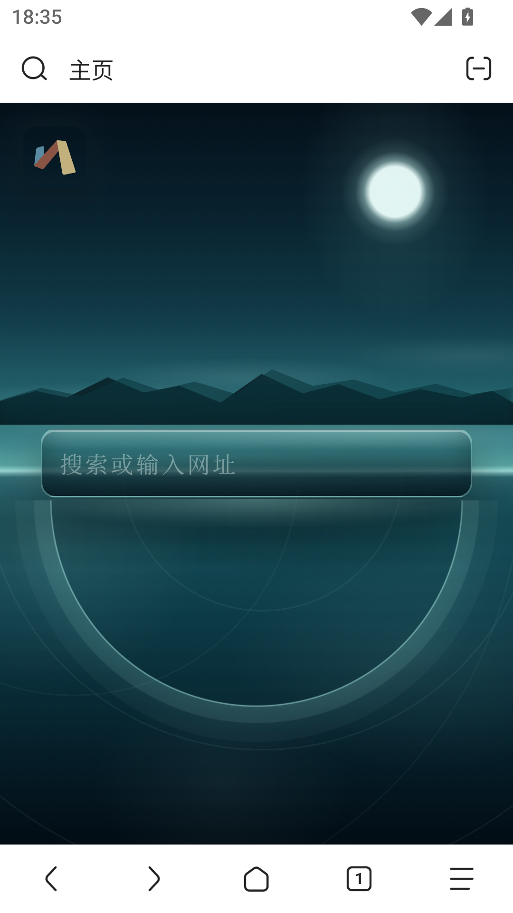
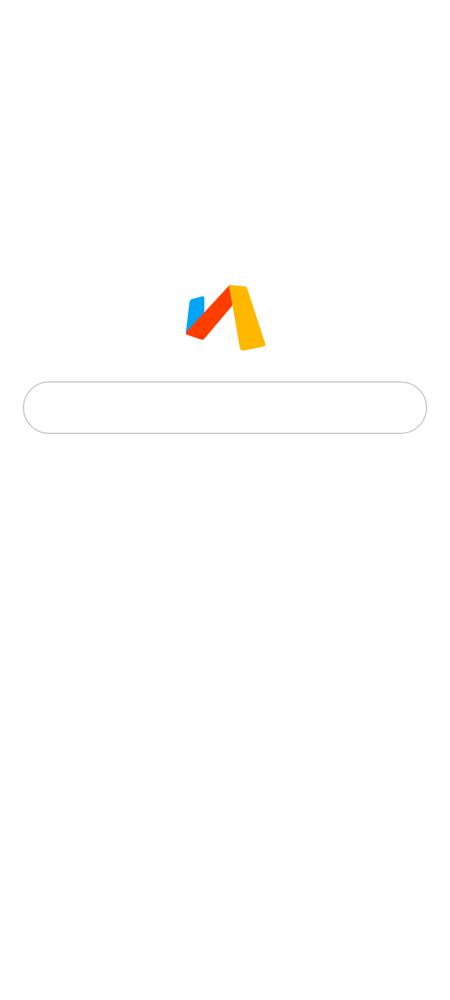
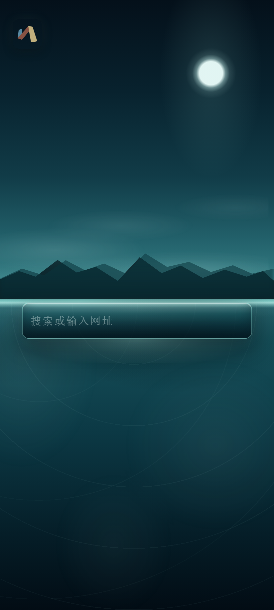
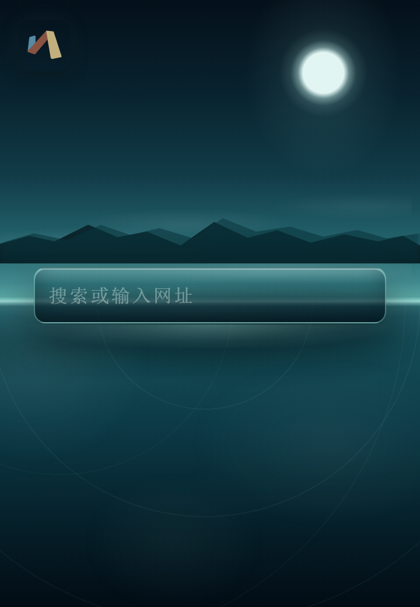

# Via 主页 · 仙侠风「水镜结界」

把 Via 的内置主页改成一片**月下寒潭**：上方是天光、云丝与两道远山剪影，下方是一整片通透水面；
搜索框压在水天线上，像浮在水面的一面镜子。**按下去，水面会荡开一圈涟漪，条子里有一道水光扫过。**

整套只有一个 CSS 段落，粘进 Via「设置 → 定制 → 自定义 CSS」即可，不改 DOM、不带脚本、不引外链资源、
不用 `backdrop-filter`（真机实测会让 WebView 闪退）。

> 本文属于 `via-home-ui/`（Via 主页 UI 项目），与仓库根目录的视频播放器插件互不引用。
> 姊妹文档：同目录 `VIA_HOME_UI_SCHEMES.md`（另外四套方案）。

---

## 0. 方案信息

| 项 | 内容 |
| --- | --- |
| 方案名称 | **仙侠风 · 水镜结界**（Xianxia · Water Mirror） |
| 适用场景 | 想要和默认白底主页**一眼可分**的沉浸式主页；喜欢水墨、月色、冷色；主页只需要「搜索 + 书签入口」两件事，不追求书签网格 |
| 依赖 | 纯 CSS。Via 设置 → 定制 → 自定义 CSS（写入 `files/homepage.css`） |
| 交互 | 点击 / 按住搜索条：水面荡开涟漪 + 条内水光横扫；按 Logo：金线外扩；按建议行：水面反光一闪 |
| 已验证 | MuMu 模拟器 + Via 7.3.3（Android 15 / WebView 110 / 1080×1920 dpr3），**真实注入 `files/homepage.css` 生效**；另在 Chromium 412×915 / 360×520 / 820×360 三档视口复核 |

效果图（真机，按住搜索条的那一帧）：



---

## 1. 与默认界面的差异

| 区域 | Via 默认主页 | 本方案 |
| --- | --- | --- |
| 背景 | 纯白，无层次 | 深潭渐变 + 月轮 + 云丝 + 远山两层 + 水下波光，分「天 / 水」两半 |
| 分界 | 无 | 49.6vh 处一条发光的**水天一线**，全幅画面最亮的地方 |
| Logo | 居中、72px、彩色大图 | 缩到 40px（热区 44px）挪到**左上角**当落款，配一条金线与收笔金点 |
| 搜索框 | 居中 46px 白描边胶囊，圆角 24px | 压在水平线上，54px、圆角 10px，半透明深水玻璃 + 顶缘水膜高光 + 底部倒影 |
| 图标位 | 聚焦后右侧出现放大镜 | 保持右侧（`order:2` 兜住默认 `float:right`），改成水光青 |
| 留白 | 上下大片空白，没有指向 | 上方「天空」留白给月与云，下方「水面」留白给涟漪，搜索条成为唯一焦点 |
| 点击反馈 | 无（直接跳原生搜索） | 水面涟漪 + 条内水光横扫 |

| Via 默认主页 | 仙侠风 · 水镜结界 |
| --- | --- |
|  |  |

---

## 2. 核心区域的排布与视觉层次

### 2.1 版面结构（412×915 实测坐标）

```
0
│    ◤ via 40px 落款（左上角）
│
│         ○  月轮（77% / 12%）
│         ～ 云丝（41% → 44%，30s 极慢漂移）
│
│    ╱╲     ╱╲╱╲      ╱╲          远山 13.8vh · blur 2.6px
│  ╱╲╱  ╲╱╲╱    ╲╱╲╱     ╲╱╲╱╲     主脊 11.4vh · blur 3px
━━━━━━━━━━━━━━━━━━━━━━━━━━━━━━━━━━━━━━━━━━━━  ← 49.6vh 水天一线（全幅唯一硬边）
│    ╭──────────────────────────────╮
│    │  搜索或输入网址                 │      ← 搜索条 54px，压线而立
│    ╰──────────────────────────────╯
│           ⌒  倒影 + 同心水纹
│
100
```

读法：`│` 是屏幕左边缘，`━━` 是水天一线；线以上是「天」，线以下是「水」。
四个区域的坐标全部相对视口高度（`vh`），所以换机型时版面比例不变。

### 2.2 四个核心区域

**① 搜索 / 地址输入区 —— 唯一的焦点，压在水天线上**

- 位置：`#content` 用 `padding-top: 49.6vh` 顶下来，条子的**上边缘正好落在水天线上**，读作"浮在水面"。
- 尺寸：高 54px、圆角 10px、外边距 0，宽度 `min(92vw, 560px)` 去掉左右 `clamp(14px,4vw,20px)` 内边距
  （412px 屏实测条宽 346px ≈ 84% 屏宽）。
- 通透感：靠**叠色**而不是模糊滤镜——上缘 `rgba(214,255,249,.22)` 当水膜、中段玉青、下缘压深；
  外加 `inset 0 1px 0 rgba(255,255,255,.34)` 的高光与 `inset 0 -12px 20px` 的压暗，条子才有厚度。
- 提示文字：Via 的输入框**没有 `placeholder` 属性**，深色水面上不写字就是一块空玻璃。
  用 `form.search_bar::before` 写一句「搜索或输入网址」（16px 宋体、`rgba(234,250,247,.40)`、字距 .12em），
  并用 `:has(#search_input:not([placeholder]))` 做条件保护——哪天 Via 自己加了 placeholder，这句自动让位。
- 热区：`#search_bar_trigger` 是覆盖整条的 `<button>`，`inset:0` + `height:auto`（默认写死 46px，
  不改会把 54px 条子的下 8px 留成死区）。

**② 背景 —— 「天」与「水」两半，靠一条亮线缝合**

全部画在 `div.frosted-glass#gesture-indicator` 上（它本来就是全屏铺底的那层），一条 `linear-gradient` 从
`#04101a` 走到 `#7cc6c1`（49.4%，水天线最亮）再落到 `#020c14`；叠一轮 `circle 38px` 的月亮、
一抹从顶部压下来的月华、两层远山、两团水下倒影。**只有 49.6% 处是硬边**，其余全是软过渡。

**③ 留白 —— 两段，各有任务**

- 天空留白（0 → 42vh）：只放月轮与云丝，给「静」；也是 Logo 与月轮形成对角线平衡的地方。
- 水面留白（56vh → 100vh）：只放同心水纹与倒影，给「动」的余地——涟漪要有地方散开，
  所以搜索条以下不留任何控件。
- 两段留白加起来占屏 80% 以上，搜索条是画面上唯一的实体，这就是「克制」的来源。

**④ 装饰层 —— 四层，全部是伪元素，零 DOM 改动**

| 层 | 载体 | 内容 | 动效 |
| --- | --- | --- | --- |
| 月与天光 | `#gesture-indicator` 背景 | 月轮、月华、远山软影、水下倒影 | 无（静止） |
| 云丝 | `#gesture-indicator::before` | 4 条贴水光线的横向雾带 | `xxMist` 30s 往复漂移 |
| 水下波光 | `#gesture-indicator::after` | 三团柔光 + 两组周期互质（92px / 148px）的同心水纹 | `xxDrift` 24s 缓慢漂移 |
| 山影 | `#content::before` / `::after` | 主脊 11.4vh（`clip-path` 折线 + `blur(3px)`）／远山 13.8vh（`blur(2.6px)`） | 无 |
| 倒影 | `.search_part::before` | 把主脊 `scaleY(-1)` 翻进水里，`blur(2px)` + 径向遮罩往下散 | 无 |

> 所有装饰层都是 `pointer-events:none`，不挡点击；`#content` 抬到 `z-index:2`，保证内容在水纹之上。

### 2.3 视觉层次（从亮到暗）

1. **水天一线**（≈ #7cc6c1，全屏最亮）→ 2. 月轮 → 3. 搜索条顶缘水膜 → 4. 条内提示文字 →
5. 山脊轮廓 → 6. 水面波光 → 7. 深水底色（#020c14）。层级只有一条规则：**越靠近水平线越亮**，
所以视线天然落在搜索条上。

---

## 3. 点击水纹：怎么做的，边界在哪

### 3.1 触发点为什么是 `.search_bar_wrapper`

真机上 Via 的主页 JS 会把 `form.search_bar` 设成 `inert` 并禁用里面的输入框，点搜索条其实调的是
`window.via.cmd(514)`（原生搜索）。所以：

- `form.search_bar:active` —— 不会触发（inert 元素不接收指针事件）；
- `.search_bar_wrapper:focus-within` —— 不会触发（输入框被 `disabled`，永远拿不到焦点）；
- ✅ `.search_bar_wrapper:active` —— 会触发：触发层是它的子元素，按下时祖先链上的 `:active` 是成立的。

水纹就挂在这一条上（`:focus-within` 留在选择器里只是兜底，某些版本可能放开输入框）。

### 3.2 两层水纹

| 层 | 载体 | 做法 |
| --- | --- | --- |
| 条内水光横扫 | `form.search_bar::after` | 一条 `linear-gradient(104deg)` 的高光带，`translateX(-101% → 101%)` 扫过，50% 处 `rgba(214,255,249,.58)` |
| 水面半圈涟漪 | `.search_bar_wrapper::before` | 一个 100% 宽的正圆描边，`clip-path: inset(50% …)` 只留下半圈，`scale(.14 → 1)` + 淡出 |

为什么不给条子里画圆环：条子只有 54px 高，圆环扩散到一半就被上下裁掉，只剩**两根竖线**，
不像水波像扫描线。所以条内走「光扫」、条外走「涟漪」，两种语言各司其职。

### 3.3 纯 CSS 的三个硬限制（必须知道）

1. **波纹原点固定**在条子中心，不能跟随手指落点——那需要 JS 读取坐标。
2. **松手后关键帧会被移除**（动效由 `:active` 驱动）。为了不让水纹"啪"地消失，
   涟漪拆成两半：**扩圈走关键帧**（`xxRippleOut` 0.62s，`scale(.14 → 1)`），
   **淡出走 `transition`**（`opacity .45s ease-out`，仅常态声明）。
   按下的瞬间圈立刻变亮、开始扩；松手时关键帧退场、`transform` 回到满径，圈再自己淡出 0.45s——
   短按看到的是"一圈完整的水波散开"，按住不放则连扩圈带淡出全看完。
3. **真机点一下就跳原生搜索**，内容会做一次 `translateY(72px)` + 淡出（这是 Via 自己的过渡），
   涟漪正好在淡出里"沉进水里"——观感成立，但它不是 1 秒长播的动画。

### 3.4 想调手感改这几个参数

| 想要 | 改哪里 |
| --- | --- |
| 涟漪更大/更小 | `xxRippleOut` 的 `scale(1)`（终点倍数） |
| 扩圈更快/更慢 | `xxRippleOut .62s`、`xxSweep .6s` 两处时长 |
| 松手后散得更快/更慢 | `.search_bar_wrapper::before` 的 `transition: opacity .45s` |
| 更亮/更淡 | 涟漪的 `border` 与 `box-shadow`、横扫的 `.58` 透明度 |

> **踩过的坑**：伪元素的基线 `opacity: 0 !important` 会**压过**关键帧——`!important` 在层叠里高于动画，
> 结果涟漪永远不显示。基线里的 `opacity` / `transform` 一律不带 `!important`。

---

## 4. 主要选择器标注及作用

### 4.1 真实 DOM（Via 7.3.3 实测，与旧版文档不同）

```
body
├─ div.frosted-glass#gesture-indicator     全屏铺底 + 下拉手势（与 #content 是兄弟，不是父子）
└─ #content                                绝对定位，无 top（靠 padding 顶下来）
   └─ .search_part
      ├─ a.logo > img.smaller              点它打开书签（via.cmd(257)）
      └─ .search_bar_wrapper
         ├─ form.search_bar                被 JS 设成 inert
         │  ├─ button#search_submit > .search.icon
         │  └─ span > input#search_input
         ├─ .opSug_wpr                     输入时由 JS 插入，默认 display:none
         └─ button#search_bar_trigger      点它 → 原生搜索（via.cmd(514)）
```

### 4.2 选择器 → 作用

| 选择器 | 作用 |
| --- | --- |
| `:root` | 四个设计令牌：`--xx-deep` 深水底、`--xx-glow` 水光青、`--xx-moon` 月白、`--xx-hz` 水天线高度 |
| `body` | 拆掉默认的 `width:600px; margin:auto`，铺满并铺深色底 |
| `.frosted-glass#gesture-indicator` | **背景层**：水天一线、月轮、月华、远山软影、水下倒影、天/水主渐变；强制全屏 `fixed` |
| `…gesture-indicator::before` | 云丝（4 条横向雾带），30s 往复漂移 |
| `…gesture-indicator::after` | 水下波光：3 团柔光 + 2 组同心水纹，24s 漂移；`top:49.6%` 只覆盖水面 |
| `#content` | 布局骨架：`top:0` + `padding-top:var(--xx-hz)` 把搜索条顶到水天线上；`z-index:2` 压在水纹之上 |
| `#content::before` | **主脊**：11.4vh 高的深色折线剪影，`clip-path` 画山形 + `blur(3px)` 去矢量感 |
| `#content::after` | **远山**：13.8vh、更淡更钝，压在主脊后面拉开纵深 |
| `.search_part` | 限宽 `min(92vw,560px)`、居中、左右内边距随屏宽伸缩 |
| `.search_part::before` | **水面倒影**：主脊 `scaleY(-1)` 翻进水里 + 径向遮罩往下散 |
| `a.logo` | Logo 从居中大图改成左上角落款；44px 热区，视觉 40px |
| `a.logo::before` | 落款金线 + 收笔金点 |
| `a.logo::after` | 按下时金线外扩一圈（`xxSeal`） |
| `img.smaller` | 图标限成 40px 方块、圆角 9px、`saturate(.30)` 褪成水墨调 |
| `.search_bar_wrapper` | 定位上下文（涟漪、倒影都挂在它的伪元素上）；`display:block` 取代默认的 `table` |
| `.search_bar_wrapper::before` | **水面涟漪**：只留下半圈的描边圆，按下时 `scale(.14→1)` |
| `.search_bar_wrapper::after` | 条子正下方的倒影光斑（径向渐变，自然散开，不用遮罩所以没有方框边） |
| `form.search_bar` | **水镜本体**：54px 高、圆角 10px、叠色玻璃、`overflow:hidden` 让水光被圆角裁掉 |
| `form.search_bar::before` | 条内提示语「搜索或输入网址」（带 `:has()` 条件保护，可整条删除） |
| `form.search_bar::after` | 条内水光横扫（`xxSweep`） |
| `form.search_bar > span` | 顶掉默认 `span{padding-left:5px}`，让输入框吃满剩余宽度 |
| `#search_input` | 52px、宋体 16px、月白色、水光青光标；**必须 `background:transparent`**（否则 WebView 给默认白底） |
| `#search_input::placeholder` | 万一日后出现真 placeholder，也保持同一套配色 |
| `.search.icon` / `#search_submit` | 图标改水光青、去背景去边框；`order:2` 保住默认的右侧位置 |
| `#search_bar_trigger` | 热区铺满整条；**显式 `background:transparent`**——它是 `<button>`，默认样式一旦丢失就会露出 UA 的 `#EFEFEF` 灰底 |
| `.opSug_wpr` | 建议面板：深水玻璃、下缘 10px 圆角、48px 行高、hairline 分隔 |
| `.opSug_wpr td:active` | 按下时水面反光一闪（`xxSurface`） |
| `@media (max-width:380px)` | 条子 50px、字号 15px |
| `@media (max-height:560px)` | 水天线降到 44vh，条子 48px（横屏/小屏不挤成一团） |
| `@media (min-width:720px)` | 条子限到 `min(70vw,560px)`，平板/桌面不拉成一根长条 |
| `@media (prefers-reduced-motion)` | 关掉环境动效，水纹缩短到 0.01ms（尊重系统"减少动态"） |

### 4.3 伪元素占用表（改样式前先看这张，别撞车）

| 元素 | `::before` | `::after` |
| --- | --- | --- |
| `#gesture-indicator` | 云丝 | 水下波光 |
| `#content` | 主脊 | 远山 |
| `.search_part` | 水面倒影 | 空闲 |
| `a.logo` | 落款金线 | 按下金圈 |
| `form.search_bar` | 条内提示语 | 水光横扫 |
| `.search_bar_wrapper` | 水面涟漪 | 条下倒影 |

---

## 5. 完整 CSS

一次只启用这一套，整段粘进「自定义 CSS」。**不要**和 `VIA_HOME_UI_SCHEMES.md` 里的另外四套同时粘贴。

```css
/* ===================================================================
   Via 主页 · 仙侠风「水镜结界」 v1
   纯 CSS：不改 DOM、不引脚本 / 框架 / 外链资源，不使用 backdrop-filter
   锚点：.frosted-glass#gesture-indicator / #content / .search_part
         a.logo / img.smaller / .search_bar_wrapper / form.search_bar
         #search_input / #search_submit / #search_bar_trigger
         .opSug_wpr / .opSug_wpr td
   =================================================================== */

/* ---- 0. 设计令牌 ----
   真正在用的 4 个变量：整体调色改这 4 个即可。
   其余色值（玉青 / 落款金等半透明色）直接写成 rgba 字面值——
   WebView 110（Chrome 110）没有 color-mix()，没法从变量派生带透明度的颜色。 */
:root {
  --xx-deep: #020c14;   /* 深水底 */
  --xx-glow: #a8f4ea;   /* 水光青：描边 / 图标 / 水纹 */
  --xx-moon: #eafaf7;   /* 月白：输入文字 */
  --xx-hz:   49.6vh;    /* 水天线高度；改这里要同步改下面渐变里的 49.6% 与 50.5% */
}

/* ---- 1. 铺满 ---- */
html, body { height: 100%; }
body {
  width: 100% !important;
  margin: 0 !important;
  background-color: var(--xx-deep) !important;
  -webkit-tap-highlight-color: transparent;
}

/* ---- 2. 水面：所有背景画在手势遮罩层上（它本来就是全屏铺底） ---- */
.frosted-glass#gesture-indicator {
  position: fixed !important;
  inset: 0 !important;
  background-color: transparent !important;
  background-image:
    /* (1) 水天线：一条被打碎的高光，水面最亮的地方 */
    linear-gradient(180deg,
      rgba(214,255,249,0) 49.4%, rgba(214,255,249,.42) 49.62%,
      rgba(214,255,249,.12) 49.95%, rgba(214,255,249,0) 50.4%),
    /* (2) 月轮 + 月华 */
    radial-gradient(circle 38px at 77% 12%, rgba(236,255,252,.95) 0 46%, rgba(208,250,245,.42) 58%, rgba(208,250,245,.10) 74%, rgba(208,250,245,0) 100%),
    radial-gradient(26% 24% at 77% 12%, rgba(168,244,234,.13), rgba(168,244,234,0) 72%),
    /* (3) 远山背后的一层薄雾：让剪影有东西可"衬" */
    radial-gradient(120% 7% at 50% 47.5%, rgba(196,255,247,.20), rgba(196,255,247,0) 76%),
    /* (4) 水中倒影：山影在近岸水面上虚虚翻了一层 */
    radial-gradient(56% 12% at 64% 55%, rgba(2,16,22,.40), rgba(2,16,22,0) 78%),
    radial-gradient(66% 8%  at 18% 57%, rgba(3,20,27,.32), rgba(3,20,27,0) 80%),
    /* (5) 水天一线：全幅主光带，天与水在这里最亮 */
    linear-gradient(180deg,
      #04101a 0%, #08222e 15%, #113c48 29%, #22606a 39%,
      #357f85 46.5%, #4e9a99 48.9%, #7cc6c1 49.4%,
      #245f68 50.5%, #164f59 56%, #0c3a46 70%, #051d27 88%, #020c14 100%);
  background-size: 100% 100%;
  background-repeat: no-repeat !important;
  pointer-events: none !important;
  isolation: isolate;
}

/* ---- 3. 装饰层 A：云雾丝带（只在天空区，极慢漂移） ---- */
.frosted-glass#gesture-indicator::before {
  content: "" !important;
  position: absolute !important;
  inset: 0 !important;
  z-index: 0;
  pointer-events: none !important;
  background-image:
    radial-gradient(46% 5% at 22% 41%, rgba(226,255,250,.16), transparent 74%),
    radial-gradient(54% 4% at 72% 44%, rgba(226,255,250,.13), transparent 76%),
    radial-gradient(36% 3.5% at 46% 37%, rgba(226,255,250,.10), transparent 78%),
    radial-gradient(30% 3% at 88% 34%, rgba(226,255,250,.08), transparent 80%);
  background-repeat: no-repeat !important;
  -webkit-animation: xxMist 30s ease-in-out infinite alternate !important;
  animation: xxMist 30s ease-in-out infinite alternate !important;
}

/* ---- 4. 装饰层 B：水下的波光（稀疏同心水纹 + 柔光斑，缓慢漂移） ---- */
.frosted-glass#gesture-indicator::after {
  content: "" !important;
  position: absolute !important;
  left: -12% !important;
  right: -12% !important;
  top: 49.6% !important;
  bottom: -8% !important;
  z-index: 0;
  pointer-events: none !important;
  background-image:
    /* 贴着水天线的散射光，把两半缝在一起 */
    radial-gradient(52% 14% at 50% 2%, rgba(206,255,248,.16), rgba(206,255,248,0) 72%),
    /* 三团柔光：水下的波光，位置刻意不对称 */
    radial-gradient(34% 46% at 17% 16%, rgba(206,255,248,.09), rgba(206,255,248,0) 70%),
    radial-gradient(40% 36% at 74% 40%, rgba(206,255,248,.07), rgba(206,255,248,0) 72%),
    radial-gradient(26% 30% at 44% 68%, rgba(206,255,248,.05), rgba(206,255,248,0) 74%),
    /* 两组周期互质的同心水纹：错开后不像网格 */
    repeating-radial-gradient(circle at 50% 0%,
      rgba(198,255,248,.055) 0 1px, rgba(198,255,248,0) 1px 92px),
    repeating-radial-gradient(circle at 22% 0%,
      rgba(198,255,248,.040) 0 1px, rgba(198,255,248,0) 1px 148px);
  background-repeat: no-repeat !important;
  background-size: 100% 100% !important;
  -webkit-animation: xxDrift 24s ease-in-out infinite alternate !important;
  animation: xxDrift 24s ease-in-out infinite alternate !important;
}

@-webkit-keyframes xxMist {
  from { transform: translate3d(-2%, 0, 0) scale(1);     opacity: .80; }
  to   { transform: translate3d(2%, 1%, 0) scale(1.06); opacity: 1; }
}
@keyframes xxMist {
  from { transform: translate3d(-2%, 0, 0) scale(1);     opacity: .80; }
  to   { transform: translate3d(2%, 1%, 0) scale(1.06); opacity: 1; }
}
@-webkit-keyframes xxDrift {
  from { transform: translate3d(-1%, 0, 0) scale(1);      opacity: .85; }
  to   { transform: translate3d(1%, 3%, 0) scale(1.06);   opacity: 1; }
}
@keyframes xxDrift {
  from { transform: translate3d(-1%, 0, 0) scale(1);      opacity: .85; }
  to   { transform: translate3d(1%, 3%, 0) scale(1.06);   opacity: 1; }
}

/* ---- 4.5 装饰层 C：远山 / 近岸剪影（贴在水平面上的两道墨线） ---- */
#content::before,
#content::after {
  content: "" !important;
  position: fixed !important;
  left: 0 !important;
  right: 0 !important;
  pointer-events: none !important;
  background-repeat: no-repeat !important;
  background-size: 100% 100% !important;
}
/* 远山：高、淡、接着雾 */
#content::before {
  top: calc(var(--xx-hz) - 12.0vh) !important;
  height: 11.4vh !important;
  background-image: linear-gradient(180deg, rgba(4,22,29,.55), rgba(4,22,29,.92) 62%, rgba(3,18,24,.98)) !important;
  -webkit-clip-path: polygon(0% 100%, 0% 72%, 7% 60%, 13% 68%, 21% 44%, 28% 62%, 35% 54%, 43% 74%, 51% 40%, 59% 63%, 66% 52%, 74% 70%, 82% 58%, 90% 68%, 96% 60%, 100% 74%, 100% 100%) !important;
  clip-path: polygon(0% 100%, 0% 72%, 7% 60%, 13% 68%, 21% 44%, 28% 62%, 35% 54%, 43% 74%, 51% 40%, 59% 63%, 66% 52%, 74% 70%, 82% 58%, 90% 68%, 96% 60%, 100% 74%, 100% 100%) !important;
  opacity: .9 !important;
}
/* 远山：更高、更淡，压在主脊后面拉开纵深 */
#content::after {
  top: calc(var(--xx-hz) - 14.4vh) !important;
  height: 13.8vh !important;
  background-image: linear-gradient(180deg, rgba(9,52,60,.30), rgba(9,52,60,.62) 70%, rgba(7,40,48,.72)) !important;
  -webkit-filter: blur(2.6px) !important;
  filter: blur(2.6px) !important;
  -webkit-clip-path: polygon(0% 100%, 0% 76%, 8% 64%, 16% 72%, 24% 54%, 31% 66%, 38% 58%, 46% 70%, 53% 46%, 61% 62%, 69% 56%, 77% 68%, 85% 60%, 92% 70%, 100% 64%, 100% 100%) !important;
  clip-path: polygon(0% 100%, 0% 76%, 8% 64%, 16% 72%, 24% 54%, 31% 66%, 38% 58%, 46% 70%, 53% 46%, 61% 62%, 69% 56%, 77% 68%, 85% 60%, 92% 70%, 100% 64%, 100% 100%) !important;
}

/* 水面倒影：把远山翻一层进水里，虚、淡、越往下越散 */
.search_part::before {
  content: "" !important;
  position: fixed !important;
  left: 0 !important;
  right: 0 !important;
  top: calc(var(--xx-hz) + .4vh) !important;
  height: 7.5vh !important;
  pointer-events: none !important;
  background-image: linear-gradient(180deg, rgba(3,20,26,.55), rgba(3,20,26,.10) 72%, rgba(3,20,26,0)) !important;
  background-size: 100% 100% !important;
  -webkit-transform: scaleY(-1) !important;
  transform: scaleY(-1) !important;
  -webkit-filter: blur(2px) !important;
  filter: blur(2px) !important;
  -webkit-mask-image: radial-gradient(120% 100% at 50% 0%, rgba(0,0,0,.90) 18%, rgba(0,0,0,.35) 62%, rgba(0,0,0,0) 92%) !important;
  mask-image: radial-gradient(120% 100% at 50% 0%, rgba(0,0,0,.90) 18%, rgba(0,0,0,.35) 62%, rgba(0,0,0,0) 92%) !important;
  -webkit-clip-path: polygon(0% 100%, 0% 92%, 8% 84%, 15% 90%, 22% 78%, 28% 86%, 34% 82%, 41% 92%, 48% 86%, 55% 94%, 62% 88%, 70% 95%, 78% 90%, 86% 96%, 93% 92%, 100% 95%, 100% 100%) !important;
  clip-path: polygon(0% 100%, 0% 92%, 8% 84%, 15% 90%, 22% 78%, 28% 86%, 34% 82%, 41% 92%, 48% 86%, 55% 94%, 62% 88%, 70% 95%, 78% 90%, 86% 96%, 93% 92%, 100% 95%, 100% 100%) !important;
  opacity: .55 !important;
}

/* ---- 5. 布局骨架：搜索条落在水天线上，其余全是留白 ---- */
#content {
  position: absolute !important;
  top: 0 !important;
  left: 0 !important;
  right: 0 !important;
  z-index: 2 !important;
  padding: var(--xx-hz) 0 0 !important;
  max-width: none !important;
  margin: 0 !important;
  box-sizing: border-box !important;
}
.search_part {
  position: static !important;      /* 让印章能相对 #content 定位 */
  display: block !important;
  width: min(92vw, 560px) !important;
  max-width: 560px !important;
  margin: 0 auto !important;
  padding: 0 clamp(14px, 4vw, 20px) !important;
  box-sizing: border-box !important;
  text-align: left !important;
}

/* ---- 6. 印章（Logo）：从居中大图改成左上角落款 ---- */
a.logo {
  position: absolute !important;
  top: clamp(16px, 3.2vh, 32px) !important;
  left: clamp(16px, 4.5vw, 30px) !important;
  display: block !important;
  width: 44px !important;
  height: 44px !important;
  margin: 0 !important;
  padding: 2px !important;   /* 视觉 40px，热区 44px */
  box-sizing: border-box !important;
  border: 0 !important;
  border-radius: 9px !important;
  background: transparent !important;
  box-shadow:
    0 4px 14px rgba(0,6,10,.45),
    0 0 20px rgba(168,244,234,.08) !important;
  z-index: 3 !important;
}
img.smaller {
  display: block !important;
  width: 100% !important;
  height: 100% !important;
  margin: 0 !important;
  border-radius: 9px !important;
  object-fit: contain !important;
  /* 褪成水墨调：留着图形轮廓，不抢水面的冷调 */
  -webkit-filter: saturate(.30) brightness(1.06) contrast(1.02) !important;
  filter: saturate(.30) brightness(1.06) contrast(1.02) !important;
  opacity: .88 !important;
}
/* 印章下方的一线落款（挂轴边），纯装饰 */
a.logo::before {
  content: "" !important;
  position: absolute !important;
  top: 100% !important;
  left: 50% !important;
  width: 1px !important;
  height: clamp(18px, 3vh, 34px) !important;
  margin-left: -.5px !important;
  background-image:
    radial-gradient(circle at 50% 100%, rgba(226,196,137,.85) 0 1.4px, rgba(226,196,137,0) 2.2px),
    linear-gradient(180deg, rgba(226,196,137,.55), rgba(226,196,137,.10) 86%, rgba(226,196,137,0)) !important;
  background-repeat: no-repeat !important;
  pointer-events: none !important;
}
/* 按下时印章外扩一圈微光 */
a.logo::after {
  content: "" !important;
  position: absolute !important;
  inset: -5px !important;
  border: 1px solid rgba(226,196,137,.78) !important;
  border-radius: 13px !important;
  opacity: 0;
  pointer-events: none !important;
}
a.logo:active::after {
  -webkit-animation: xxSeal .62s ease-out both !important;
  animation: xxSeal .62s ease-out both !important;
}
@-webkit-keyframes xxSeal {
  0%   { opacity: .9; transform: scale(1); }
  100% { opacity: 0;  transform: scale(1.55); }
}
@keyframes xxSeal {
  0%   { opacity: .9; transform: scale(1); }
  100% { opacity: 0;  transform: scale(1.55); }
}

/* ---- 7. 搜索条：浮在水面上的一片水镜 ---- */
.search_bar_wrapper {
  position: relative !important;
  display: block !important;
  width: 100% !important;
  max-width: none !important;
  margin: 0 !important;
}
form.search_bar {
  position: relative !important;
  display: flex !important;
  align-items: center !important;
  width: 100% !important;
  max-width: none !important;
  height: 54px !important;
  margin: 0 !important;
  padding: 0 10px !important;
  box-sizing: border-box !important;
  border: 1px solid rgba(168,244,234,.38) !important;
  border-radius: 10px !important;
  /* 通透靠"叠色"而不是模糊滤镜：上缘薄雾 + 中段水色 + 下缘深 */
  background:
    linear-gradient(180deg,
      rgba(214,255,249,.22) 0%,
      rgba(16,74,82,.52) 30%,
      rgba(6,40,50,.62) 62%,
      rgba(2,18,26,.70) 100%) !important;
  box-shadow:
    inset 0 1px 0 rgba(255,255,255,.34),
    inset 0 -12px 20px rgba(2,14,22,.34),
    0 12px 30px rgba(0,6,10,.45),
    0 0 24px rgba(168,244,234,.10) !important;
  overflow: hidden !important;   /* 让水纹被圆角裁掉，只剩波纹 */
}
/* 水纹之内层：一道水光从条子上横扫而过（54px 高的条子里画圆环只会变成两根竖线） */
form.search_bar::after {
  content: "" !important;
  position: absolute !important;
  inset: 0 !important;
  background: linear-gradient(104deg,
    rgba(214,255,249,0) 32%,
    rgba(214,255,249,.20) 42%,
    rgba(214,255,249,.58) 50%,
    rgba(214,255,249,.20) 58%,
    rgba(214,255,249,0) 68%) !important;
  -webkit-transform: translateX(-101%);
  transform: translateX(-101%);
  opacity: 0;
  pointer-events: none !important;
}
/* 触发点只能挂在 .search_bar_wrapper 上：Via 主页把 form 设成了 inert，
   form 自身的 :active / :focus-within 永远不会触发 */
.search_bar_wrapper:active form.search_bar::after,
.search_bar_wrapper:focus-within form.search_bar::after {
  -webkit-animation: xxSweep .6s cubic-bezier(.25,.55,.35,1) both !important;
  animation: xxSweep .6s cubic-bezier(.25,.55,.35,1) both !important;
}
@-webkit-keyframes xxSweep {
  0%   { opacity: 0;   -webkit-transform: translateX(-101%); }
  18%  { opacity: .95; }
  70%  { opacity: .55; }
  100% { opacity: 0;   -webkit-transform: translateX(101%); }
}
@keyframes xxSweep {
  0%   { opacity: 0;   transform: translateX(-101%); }
  18%  { opacity: .95; }
  70%  { opacity: .55; }
  100% { opacity: 0;   transform: translateX(101%); }
}

/* 溅出水面的外圈涟漪（只留下半圈，在水面上扩散）
   扩圈交给关键帧，淡出交给 transition：
   这样松手后关键帧被移除时，圈不会"啪"地消失，而是跳回满径再自己散掉 */
.search_bar_wrapper::before {
  content: "" !important;
  position: absolute !important;
  left: 50% !important;
  top: calc(100% + 2px) !important;
  width: 100% !important;
  aspect-ratio: 1 / 1;
  /* 只留下半圈：涟漪是在水面上扩散，不该翻过搜索条 */
  -webkit-clip-path: inset(50% -12% -12% -12%) !important;
  clip-path: inset(50% -12% -12% -12%) !important;
  transform: translate(-50%,-50%) scale(1);
  border-radius: 50% !important;
  border: 1px solid rgba(190,255,248,.55) !important;
  box-shadow:
    0 0 0 12px rgba(190,255,248,.09),
    0 0 0 26px rgba(190,255,248,.04),
    0 0 30px rgba(168,244,234,.14);
  opacity: 0;
  -webkit-transition: opacity .45s ease-out;
  transition: opacity .45s ease-out;
  pointer-events: none !important;
}
.search_bar_wrapper:active::before,
.search_bar_wrapper:focus-within::before {
  opacity: .95;
  -webkit-transition: none;
  transition: none;
  -webkit-animation: xxRippleOut .62s cubic-bezier(.2,.5,.3,1) both !important;
  animation: xxRippleOut .62s cubic-bezier(.2,.5,.3,1) both !important;
}
@-webkit-keyframes xxRippleOut {
  from { -webkit-transform: translate(-50%,-50%) scale(.14); }
  to   { -webkit-transform: translate(-50%,-50%) scale(1); }
}
@keyframes xxRippleOut {
  from { transform: translate(-50%,-50%) scale(.14); }
  to   { transform: translate(-50%,-50%) scale(1); }
}

/* 条子正下方的倒影：让搜索条真的"立在水上" */
.search_bar_wrapper::after {
  content: "" !important;
  position: absolute !important;
  left: -4px !important;
  right: -4px !important;
  top: calc(100% + 1px) !important;
  height: 36px !important;
  background: radial-gradient(64% 140% at 50% 0%,
    rgba(178,248,238,.26) 0%, rgba(178,248,238,.09) 46%, rgba(178,248,238,0) 80%) !important;
  pointer-events: none !important;
}

/* 条子里的一句提示：Via 主页的输入框没有 placeholder 属性，
   深色水面上不放字会读成一块空玻璃。删掉这一条即回到纯空框。
   :has() 是条件保护——哪天 Via 给输入框加了真 placeholder，这里自动让位。 */
.search_bar_wrapper:has(#search_input:not([placeholder])) form.search_bar::before {
  content: "搜索或输入网址" !important;
  position: absolute !important;
  left: 12px !important;
  top: 50% !important;
  transform: translateY(-50%) !important;
  color: rgba(234,250,247,.40) !important;
  font-size: 16px !important;
  font-family: "Noto Serif CJK SC", "Songti SC", "SimSun", serif !important;
  letter-spacing: .12em !important;
  pointer-events: none !important;
}

/* ---- 8. 输入区 ---- */
form.search_bar > span {
  display: block !important;
  flex: 1 1 auto !important;
  min-width: 0 !important;
  height: 100% !important;
  padding: 0 !important;
}
#search_input {
  display: block !important;
  flex: 1 1 auto !important;
  width: 100% !important;
  height: 52px !important;
  min-width: 0 !important;
  padding: 0 4px !important;
  border: 0 !important;
  background: transparent !important;
  color: var(--xx-moon) !important;
  font-size: 16px !important;
  font-family: "Noto Serif CJK SC", "Songti SC", "SimSun", serif !important;
  letter-spacing: .04em !important;
  caret-color: var(--xx-glow) !important;
  box-shadow: none !important;
  outline: none !important;
}
#search_input::placeholder {
  color: rgba(234,250,247,.84) !important;
  letter-spacing: .12em !important;
}
.search.icon,
#search_submit {
  color: var(--xx-glow) !important;
  background: transparent !important;
  border: 0 !important;
}
#search_submit {
  order: 2 !important;         /* 默认 float:right，图标在输入框右侧，别打乱 */
  position: static !important;
  flex: 0 0 auto !important;
  float: none !important;
  width: 40px !important;
  height: 44px !important;
  padding: 0 !important;
}
/* 触发层与条子同形，热区 = 整条 54px */
#search_bar_trigger {
  position: absolute !important;
  inset: 0 !important;
  background: transparent !important;  /* 它是 <button>：默认样式若被覆盖会露出 UA 的浅灰底 */
  border: 0 !important;
  padding: 0 !important;
  width: 100% !important;
  height: auto !important;   /* 默认 height:46px，会把条子下半截留成死区 */
  border-radius: 10px !important;
}

/* ---- 9. 搜索建议：水下的另一层玻璃 ---- */
.opSug_wpr {
  background: rgba(3,22,29,.94) !important;
  border: 1px solid rgba(168,244,234,.28) !important;
  border-top: none !important;
  border-radius: 0 0 10px 10px !important;
  box-shadow: 0 16px 32px rgba(0,6,10,.50) !important;
  overflow: hidden !important;
  margin-top: 0 !important;
}
.opSug_wpr table { width: 100% !important; }
.opSug_wpr td {
  height: 48px !important;
  padding: 0 16px !important;
  color: var(--xx-moon) !important;
  font-size: 15px !important;
  line-height: 48px !important;
  border-bottom: 1px solid rgba(168,244,234,.12) !important;
  white-space: nowrap !important;
  overflow: hidden !important;
  text-overflow: ellipsis !important;
}
.opSug_wpr tr:last-child td { border-bottom: 0 !important; }
.opSug_wpr td:active {
  -webkit-animation: xxSurface .5s ease-out both !important;
  animation: xxSurface .5s ease-out both !important;
}
@-webkit-keyframes xxSurface {
  0%   { background-color: rgba(168,244,234,.26); }
  100% { background-color: rgba(168,244,234,0); }
}
@keyframes xxSurface {
  0%   { background-color: rgba(168,244,234,.26); }
  100% { background-color: rgba(168,244,234,0); }
}

/* ---- 10. 窄屏 / 短屏 / 宽屏 ---- */
@media (max-width: 380px) {
  form.search_bar { height: 50px !important; }
  #search_input { height: 48px !important; font-size: 15px !important; }
}
@media (max-height: 560px) {
  :root { --xx-hz: 44vh; }
  form.search_bar { height: 48px !important; }
  #search_input { height: 46px !important; }
  .search_bar_wrapper::after { height: 20px !important; }
}
@media (min-width: 720px) {
  .search_part { width: min(70vw, 560px) !important; }
}

/* ---- 11. 尊重系统"减少动态" ---- */
@media (prefers-reduced-motion: reduce) {
  .frosted-glass#gesture-indicator::before,
  .frosted-glass#gesture-indicator::after {
    -webkit-animation: none !important;
    animation: none !important;
  }
  form.search_bar::after,
  .search_bar_wrapper::before,
  a.logo::after,
  .opSug_wpr td {
    -webkit-animation-duration: .01ms !important;
    animation-duration: .01ms !important;
  }
}
```

---

## 6. 注入、切换与回退

**注入**：Via → 菜单 → 设置 → 定制 → 自定义 CSS → 粘贴上面整段 → 保存 → 回主页刷新
（部分版本写作「定制 → 高级 → 自定义 CSS」，按界面找即可）。

**切换**：换方案 = 清空输入框、粘贴另一套。所有类名/动画名都带 `xx` 前缀、不覆盖任何通用选择器，
不会残留；想整体换色只改 `:root` 里那 4 个变量。

**回退**：清空输入框保存即恢复默认；所有规则都在 `!important` 覆盖层，不修改页面结构与 JS。

**三个可关的零件**（都不影响其他部分）：

| 想关掉 | 删掉哪一条 |
| --- | --- |
| 条内提示语 | `.search_bar_wrapper:has(#search_input:not([placeholder])) form.search_bar::before { … }` 整条 |
| 环境动效（云丝/波光） | 两个 `xxMist` / `xxDrift` 的 `animation` 声明 |
| 落款金线 | `a.logo::before` 整条 |

---

## 7. 响应式与可读性

| 视口 | 水天线 | 条子高 | Logo | 实测 |
| --- | --- | --- | --- | --- |
| 412×915（主流手机） | 49.6vh → 454px | 54px | 44px 热区 | 条宽 346px，提示语单行不折 |
| 360×520（小屏/分屏） | 44vh → 229px | 48px | 44px 热区 | 条宽 302px，仍在安全区内 |
| 820×360（横屏） | 44vh → 158px | 48px | 44px 热区 | 条宽 520px，居中不失衡 |

- **触控热区**：搜索条 54px（触发层铺满整条）、Logo 44×44px、建议行 48px —— 均 ≥44px。
- 小屏实测（360×520）：水天线降到 44vh、条子 48px、提示语仍单行，见下图。

  
- **可读性**：月白 `#eafaf7` 落在深水上对比度约 13:1；提示语 `rgba(234,250,247,.40)` 故意压低，
  读作占位符而不是正文；建议行 15px 常规字重、48px 行高，长 URL 用省略号截断。
- **不叠字**：提示语与输入文字分居伪元素/输入框两层，输入框背景透明，不会互相遮挡。
- **减少动态**：`prefers-reduced-motion: reduce` 下环境动效全关，水纹时长压到 0.01ms。

---

## 8. 验证记录

**真机（MuMu + Via 7.3.3 / Android 15 / WebView 110，1080×1920 dpr3）**

1. 把本段 CSS 追加到 `/data/data/mark.via/files/homepage.css`（Via 的「自定义 CSS」就是写这个文件），
   `force-stop` 后重启 Via，主页正常渲染：月轮、两层山脊、水天一线、水镜搜索条、水下波光全部到位，
   **无闪退、无黑屏**（`filter: blur()`、`clip-path`、`mask-image` 在 WebView 110 均正常）。
2. 按住搜索条 600ms、在第 300ms 抓帧：水面半圈涟漪已扩散到接近满径、条内水光横扫可见；
   松手后 Via 原生搜索接管，主页未被销毁，涟漪按设计淡出。
3. 验证完把 `homepage.css` 还原为原始 5661 字节，逐字节比对一致。

**桌面（Chromium，真实主页 HTML + 默认 CSS 追加注入）**：412×915 / 360×520 / 820×360 三档截图核对
排布、对齐与留白；计算样式确认条子 54px、触发层铺满、输入框背景透明、`order:2` 生效。

> 真机排查记一笔：这一轮踩过三个坑，都写进代码注释了。
> ① 如果把主页 CSS **整份替换**（而不是追加），`<button id="search_bar_trigger">`
> 会退回 UA 的 `buttonface`（#EFEFEF）灰底，整条搜索框变成白块。所以这两条复位是**必需的**：
> 触发层显式 `background:transparent`、输入框显式 `background:transparent`。
> ② 别给基线 `opacity`/`transform` 加 `!important`，那会压过关键帧（见 3.4）。
> ③ 主页 JS 会把 `form.search_bar` 设成 `inert`，`:active` / `:focus-within` 必须挂在
> `.search_bar_wrapper` 上（见 3.1）。

---

## 9. 已知限制

- **点击不跟随坐标**、**松手即收**、**不能延时播放**——三条都是纯 CSS 的天花板，要突破只能上 JS。
- Via 的不同版本主页 DOM 可能微调；本方案只用到 `#gesture-indicator`、`#content`、`.search_part`、
  `a.logo`、`img.smaller`、`.search_bar_wrapper`、`form.search_bar`、`#search_input`、`#search_submit`、
  `#search_bar_trigger`、`.opSug_wpr`（含 `td`）这批 7.3.3 上确认存在的锚点，
  若某版本改名，对应那一块会**静默失效但不报错**，不影响其他部分。
- 主页没有书签网格（Via 7.x 已把书签移到独立页），所以本方案不含「快捷入口」排布；
  需要网格请用自定义 HTML 主页。
- 山脊是 `clip-path` 折线 + 模糊做出来的**意象**，不是真实地形；想要更写实的远山，
  把 `#content::before/::after` 换成一张 `background-image: url(...)` 即可（会引外链，故默认不用）。
